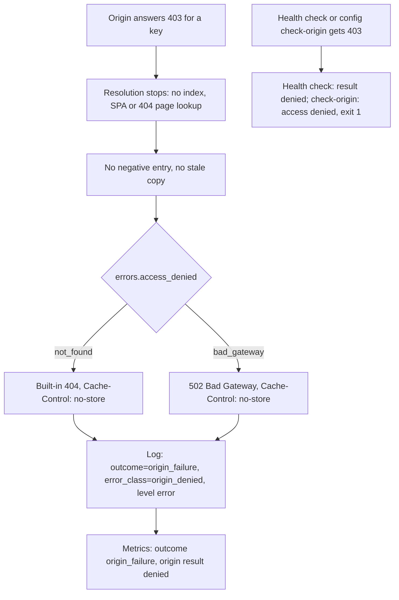

# Access denied

When the origin answers 403 Forbidden, statica treats the answer as a failure, not as a missing object. It stops resolving the URL, does not record the key as missing, and answers either 404 Not Found or 502 Bad Gateway, depending on `errors.access_denied`. Logs, metrics and health checks keep the denial visible even when the public status hides it.

## What counts as a denial

Every origin response with status 403 to a GET or HEAD is a denial, whatever error code the provider puts in it. A denial can answer any key statica reads for a request: the exact key, the index key, a precompressed sibling, the SPA shell, the custom 404 page or a guarded range read.

S3 providers also use 403 for requests they cannot authenticate. AWS, for example, answers an unknown access key or a signature mismatch with 403. As a result, wrong credentials, a bucket policy that denies the read and a missing `s3:ListBucket` permission (see [below](#aws-without-s3-listbucket)) look the same: all are logged with `error_class=origin_denied` and counted with `result="denied"`. With the default `errors.access_denied: not_found`, wrong credentials make every URL that reads the bucket answer 404, and `config check-origin` reports `access denied`.

## What statica does with a 403

The diagram follows a 403 from the origin to the public response and to the signals that report it.



## Why a 403 is not an absence

A 403 says that the origin refused the read, not that the object does not exist. If statica treated it as an absence, a broken credential or bucket policy could look like a working site: the trailing-slash redirect, the SPA shell with status 200 for every URL, or the custom 404 page would hide the failure. So:

- **No fallbacks.** Resolution stops at the denied key. No lookup of the index object, the SPA shell or the custom 404 page follows, and a denied precompressed sibling does not fall back to the canonical object.
- **No negative entry.** The memory cache records nothing for a denied key, so the next request asks the origin again, and restored access takes effect at once.
- **The entry is removed.** When the 403 answers a shared fill, a revalidation or a HEAD request's metadata read, statica also removes the entry it held for the key, whatever its kind.
- **No stale service.** Once the origin answers 403 for a key, statica never serves a stored copy of it: `cache.stale_if_error` covers origin timeouts, throttling, transport errors and unclassified provider errors only.

::: warning A revoked permission takes effect at expiry
The memory cache serves a fresh entry without asking the origin. When you revoke read access to an object, statica keeps serving its fresh entry until the entry expires, after `cache.ttl`, the TTL of a matching `cache.rules` entry, or a shorter lifetime the origin's own metadata sets. Only the next read from the origin sees the 403. Restart statica to empty the memory cache at once.
:::

## `errors.access_denied`

| Value | Public response |
| --- | --- |
| `not_found` | 404 Not Found with statica's built-in body and `Cache-Control: no-store` |
| `bad_gateway` | 502 Bad Gateway with `Cache-Control: no-store` |

Both values log and count the request the same way; only the public status (and the `status` label) differs.

```yaml [config.yaml]
errors:
  access_denied: bad_gateway
```

- With `errors.access_denied: not_found`, the 404 uses the built-in body even when the top-level `not_found` key configures a custom 404 page, because resolution stops before reading it.
- A masked denial can always be told apart from a genuine 404: a genuine 404 carries `Vary: Accept-Encoding` (and the custom 404 page's body, when one is configured), while a masked denial carries neither.
- Choose `bad_gateway` when the HTTP status itself should show the failure, for example to a load balancer or a CDN that reports 5xx rates. Choose `not_found` when visitors should see an ordinary "not found".

## AWS without `s3:ListBucket`

AWS S3 answers a GET or HEAD for a key that does not exist with 403 instead of 404 when the requester lacks the `s3:ListBucket` permission on the bucket (see the [GetObject permissions](https://docs.aws.amazon.com/AmazonS3/latest/API/API_GetObject.html) in the AWS documentation). Under the rules above, every missing URL then counts as a denial:

- `/guide` no longer redirects to `/guide/`, because the denied exact key `guide` stops resolution before the index lookup;
- the SPA fallback and the custom 404 page are never used;
- every request for a missing URL is logged at `error` level as an origin failure, and, without a negative entry, reaches the origin each time;
- a missing origin health key gives the result `denied`, and `statica config check-origin` reports `access denied` for a missing key.

No serving path in statica lists a bucket. The permission matters only because it lets AWS tell a missing key apart from a denied one. Whether to grant it is a decision for your bucket policy ([the `s3:ListBucket` trade-off](../guide/s3-providers.md#the-s3-listbucket-trade-off)).

::: warning Masking cannot restore missing-key discovery
`errors.access_denied: not_found` makes a denial look like a 404 to visitors, but the request still counts as a denial and runs no fallback. Masking cannot turn a 403 back into a reliable "missing object".
:::

## How a denial shows up

### Logs

The `http_request` access event of a denied request has `level=error` and:

- `status=404` (or `status=502` with `bad_gateway`);
- `outcome=origin_failure`;
- [`error_class=origin_denied`](../reference/logs.md#error-class);
- `termination_reason=origin_failure`;
- no `resolution` and no `origin_key` field, because no object was selected.

A genuine missing object, by contrast, is logged at `info` with `outcome=success` and `resolution=not_found`.

### Metrics

- `statica_http_requests_total` counts the request with `outcome="origin_failure"` and `status="404"` (or `"502"`).
- [`statica_origin_operations_total`](../reference/metrics.md#statica-origin-operations-total) and [`statica_origin_attempts_total`](../reference/metrics.md#statica-origin-attempts-total) count the origin call with `result="denied"`, labeled by operation (`get` or `head`) and purpose (`request`, `cache_fill` or `health`).
- `statica_cache_fill_duration_seconds` records a shared fill that the 403 ended with `result="denied"`.
- `statica_origin_health_checks_total{result="denied"}` counts denied background health checks.

### Origin health check

When `admin.origin_health` is enabled, a background worker reads the metadata of `admin.origin_health.key` with a single-attempt HEAD request that bypasses the memory cache. A 403 gives the raw result `denied`, which counts as a failure:

- before a first success, readiness stays not ready with the reason `origin_unknown`, and the worker logs `origin_health_check_failed` at `warn` with `result=denied` each time the result changes, not on every check;
- after `admin.origin_health.failure_threshold` consecutive failures of a healthy origin, readiness becomes not ready with the reason `origin_unhealthy`, and the worker logs `origin_health_changed` at `error` with `result=denied`. When `admin.origin_health.max_staleness` passes since the last success before that threshold is reached, readiness first reports `origin_stale`.

In each case [`/readyz`](../reference/admin-endpoints.md#readyz) answers 503 Service Unavailable with the reason.

The health result is the raw origin answer: `errors.access_denied` never turns it into `not_found`.

### `config check-origin`

`statica config check-origin` reads `admin.origin_health.key` when it is set, or the `index` object otherwise, with a HEAD request (and a GET when a HEAD 404 is ambiguous). A 403 is always a failure, whatever `errors.access_denied` says: the command prints

```text
statica: origin check failed: access denied
```

on standard error and exits with status 1.

## Why status-only monitoring misses it

With the default `not_found`, a denial is a 404, which looks like the ordinary 404s that crawlers and broken links produce every day. An alert on 5xx rates sees nothing, and a 404 rate rarely stands out. Watch the outcome instead: `statica_http_requests_total{outcome="origin_failure"}`, `statica_origin_operations_total{result="denied"}`, the `error` level access events with `error_class=origin_denied`, and readiness when the origin health check is enabled. [Every URL answers 404](../guide/troubleshooting.md#every-url-answers-404) shows how to tell a denial from a wrong prefix.

## What statica does not do

- It does not offer a mode that treats a 403 as an absence and continues with the fallbacks.
- It does not retry a denied read itself, list the bucket or change permissions. Within `s3.max_attempts`, the AWS SDK may retry a 403 whose error code and response `Date` point to a skewed local clock, after correcting its signing time.
- It does not store a negative entry for a denied key or serve a stale copy of it.
- It does not show the custom 404 page for a denied URL.

## Related pages

- [Request flow and URL mapping](./request-flow.md): how other origin results map to responses.
- [Memory cache](./memory-cache.md): negative entries and `stale_if_error`.
- [Startup, readiness and shutdown](./lifecycle.md): readiness and the origin health check.
- [SPA fallback](./spa-fallback.md): which lookups must end in a confirmed absence before the shell is served.
- [Precompressed variants](./precompressed-variants.md): a denied sibling stops negotiation.
- [Timeouts and long downloads](./timeouts.md): the other ways a request ends as an origin failure.
- [Connect to S3 and S3-compatible providers](../guide/s3-providers.md#the-s3-listbucket-trade-off): the `s3:ListBucket` trade-off and the choice of `errors.access_denied`.
- [Troubleshooting](../guide/troubleshooting.md#every-url-answers-404): from a 404 to its cause.
- [Log reference](../reference/logs.md#error-class), [Metrics reference](../reference/metrics.md#origin) and [Admin endpoints reference](../reference/admin-endpoints.md#readyz): the fields, series and readiness reasons named on this page.
- [Configuration reference](../reference/configuration.md#errors-access-denied): `errors.access_denied`.
