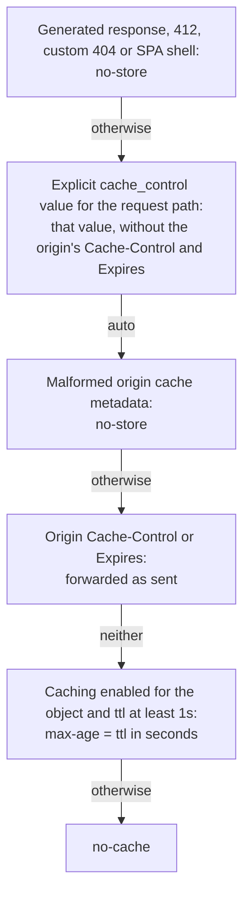

# Cache-Control and Age

Two policies stay apart: [`cache`](../reference/configuration.md#cache) decides what **statica** stores in its memory cache, and [`cache_control`](../reference/configuration.md#cache-control) decides the `Cache-Control` header that browsers and CDNs receive. This page explains how that header is chosen for every response, which path each kind of rule matches, and how `Age` reports the age of every response built from an object, whether it was served from memory or read from the origin. [Control browser and CDN caching](../guide/browser-caching.md) shows how to choose a policy for a site.

## Two separate policies

- `cache` and its [`cache.rules`](../reference/configuration.md#cache-rules) control statica's own memory: what it stores, for how long, and when it revalidates. Their rules match the **object path**. See [Memory cache](./memory-cache.md).
- `cache_control`, with [`cache_control.default`](../reference/configuration.md#cache-control-default) and [`cache_control.rules`](../reference/configuration.md#cache-control-rules), controls the policy advertised to clients. Its rules match the **public request path**. Each value is either `auto` or a valid `Cache-Control` value, which configuration validation checks.

The two meet in one place only: when `cache_control` is `auto` and the origin sent neither `Cache-Control` nor `Expires`, the object's configured [`cache.ttl`](../reference/configuration.md#cache-ttl) becomes a `max-age`. Any origin `Cache-Control`, even `Cache-Control: public`, prevents that projection.

A `cache_control` value never changes what statica stores. An explicit value does not let statica store an object whose origin metadata says `no-store`, and statica's own copy still expires as the origin's metadata and `cache.ttl` say.

`cache_control` sets only `Cache-Control`; an explicit value also drops the origin's `Expires`. `Age` and `Date` cannot be configured, and [`headers.set`](../reference/configuration.md#headers-set) cannot set `Cache-Control`, `Expires`, `Age` or `Date`: configuration validation rejects them.

## Precedence

The `Cache-Control` of each response is chosen in this order.



1. **Generated and fallback responses get `no-store`.** Generated responses carry `Cache-Control: no-store`: redirects (configured rules and the 308 to a trailing slash), rejections, error responses, the built-in 404, 416 Range Not Satisfiable and CORS preflight responses. So do 412 Precondition Failed, the custom 404 page and the single-page-app shell, although they come from objects. No origin `Expires` is sent with them, and `cache_control` does not apply to them, even when their path matches a rule.
2. **An explicit value wins.** The first `cache_control.rules` entry whose `match` covers the request path decides, or `cache_control.default` when none does. When that value is not `auto`, it is sent as configured, and the origin's `Cache-Control` and `Expires` are not sent. `Age` and `Date` are still sent, as described [below](#age): an override does not make a stored copy younger.
3. **With `auto`, malformed origin metadata gets `no-store`.** When the origin's `Cache-Control`, `Expires`, `Date` or `Age` is malformed, as defined in [Memory cache](./memory-cache.md#malformed-origin-metadata), the response gets `Cache-Control: no-store` and none of those origin headers. The access log records [`cache_diagnostic=malformed_origin_cache_metadata`](../reference/logs.md#cache-diagnostic), and statica never stores the object.
4. **With `auto`, the origin's policy is forwarded.** When the origin sent `Cache-Control`, it is forwarded unchanged, restrictive directives included, with the origin's `Expires` when there is one. When the origin sent only `Expires`, it is forwarded and no `Cache-Control` is added. The publisher's policy wins even when statica's own lifetime is shorter: an origin `max-age=3600` reaches clients as `max-age=3600` with `cache.ttl: 5m`, while statica's own copy becomes stale after five minutes and is revalidated on the next request.
5. **With `auto` and no origin policy, the lifetime is projected.** The effective cache policy of the selected object decides: the first `cache.rules` entry matching the object path, over the global `cache` values. When caching is enabled for the object and its `ttl` is at least one second, the response gets `Cache-Control: max-age=` followed by the `ttl` in whole seconds, for example `max-age=300` for `ttl: 5m`. Otherwise, when caching is disabled for the object, globally or by a rule, or its `ttl` is below one second, the response gets `Cache-Control: no-cache`.

Rules 2 to 5 apply to 200 OK, 206 Partial Content and 304 Not Modified responses, to `GET` and `HEAD` alike. A 304 carries the same `Cache-Control`, `ETag` and `Age` as the 200 it stands for.

A rule whose value is `auto` applies the automatic policy to the paths it matches, for example to keep `auto` for some paths under an explicit default.

```yaml [config.yaml]
cache_control:
  default: auto
  rules:
    - match:
        prefix: /assets/
      value: public, max-age=31536000, immutable
    - match:
        exact: /
      value: no-cache
```

## Which path a rule matches

`cache_control.rules` match the public request path, decoded once, as the client sent it. `cache.rules` match the path of the object statica selected: its key relative to the publication prefix, with a leading slash. The two differ whenever resolution selects another object than the path names:

| Request | `cache_control.rules` see | `cache.rules` see |
| --- | --- | --- |
| `/guide/` | `/guide/` | `/guide/index.html` |
| `/` | `/` | `/index.html` |
| `/assets/app.js`, served as its Brotli variant | `/assets/app.js` | `/assets/app.js.br` |
| `/a%20b.txt` | `/a b.txt` | `/a b.txt` |

In both kinds of rules, `exact` matches one path. A `prefix` ends with a slash and matches every path that starts with it, and also the same path without the trailing slash: `prefix: /assets/` matches `/assets/app.js` and `/assets`. `prefix: /` matches every path. The first matching rule wins.

So a projected `max-age` for a precompressed variant follows the rules that match the variant's path: a `cache.rules` entry with `exact: /assets/app.js` does not apply to `/assets/app.js.br`, while a `prefix` rule covers both.

## Configuration, not residency

The projected `max-age` depends on the configured `enabled` and `ttl` of the object, never on whether the object is currently in memory. A large object that streams, a range read from the origin, a request that bypasses the cache and the first request for an object get the same header as a response served from memory. Size and capacity limits decide only what statica stores. If large downloads need another policy, give their paths an explicit `cache_control` rule.

## Age

Every 200, 206, 304 or 412 response for an object carries the origin's `Date` when it is a valid HTTP date, and `Age` whenever the age is at least one second. The SPA shell, a 404 with the `not_found` object and a response that malformed origin cache metadata made `no-store` carry no `Age`, and their `Date` is the time of the response. The age is computed this way:

- On a response served from memory (a hit, a revalidated entry, a stale copy, a range cut from memory, or the body that the request's own fill has just stored), `Age` is the entry's current age, in whole seconds, as RFC 9111, section 4.2.3 defines it.
- On a response read from the origin, `Age` is the larger of the origin's own `Age` and the time elapsed since the origin's `Date`.

Ages saturate at 2^31 seconds (2147483648).

`Cache-Control` does not change from one hit to the next: a hit never renews the lifetime, and the age is never subtracted from `max-age`. A client computes the remaining freshness from both headers, so subtracting the age in statica as well would count it twice.

For example, an object without origin cache headers, under `ttl: 5m`, is sent with `Cache-Control: max-age=300`. When statica serves it from memory at an age of 120 seconds, the response carries `max-age=300` and `Age: 120`, which leaves a client about 180 seconds of freshness. The response never says `max-age=180`.

After a successful revalidation, `Date` and `Age` come from the origin's 304 answer, so the age restarts from that exchange. Serving a stale copy under [`cache.stale_if_error`](../reference/configuration.md#cache-stale-if-error) does not renew anything: `Age` keeps growing.

## What statica never infers

- No `public`, `immutable`, `s-maxage`, `stale-if-error` or `stale-while-revalidate` directive is ever added. The projection produces only `max-age=N` or `no-cache`, whatever the internal `ttl`.
- `cache.negative_ttl` is never advertised: 404 responses are always `no-store`.
- In `auto` mode, a `Cache-Control` the origin sent is never rewritten, to shorten or to lengthen it.
- No `Expires` header is ever computed: only the origin's is forwarded.

## What statica does not do

- It does not vary `Cache-Control` by client, hostname or query.
- It does not purge or notify CDNs and other downstream caches.
- It does not let `headers.set` override the freshness headers.

## Related pages

- [Memory cache](./memory-cache.md)
- [Request flow and URL mapping](./request-flow.md)
- [Architecture overview](./index.md)
- [Control browser and CDN caching](../guide/browser-caching.md): common policies, per path or per object.
- [HTTP responses reference](../reference/http-responses.md#cache-control): the `Cache-Control`, `Expires`, `Age` and `Date` of each response.
- [Log reference](../reference/logs.md#cache-diagnostic): the `cache_diagnostic` field.
- [Configuration reference](../reference/configuration.md#cache-control): the `cache_control` keys.
