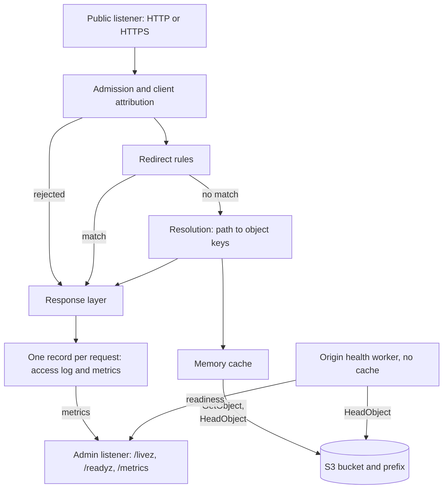

# Architecture overview

**statica** is one process that serves one S3 bucket, or one prefix inside it, as one website. Every request follows the same path: the public listener accepts it, admission checks decide whether statica handles it, redirect rules may answer it at once, and resolution maps its path to object keys that are read through a bounded memory cache from the origin. A separate admin listener exposes liveness, readiness and metrics. This page states the principles behind that design and introduces each component. The other Architecture pages describe the mechanisms in detail. For what statica offers and where it fits in a deployment, start with [What is statica?](../guide/what-is-statica.md).

## Design principles

### One site per instance

A configuration has one `s3` block: one bucket and an optional publication prefix (`s3.prefix`). Every request that passes admission is served from that origin, whatever hostname it was sent to. To serve several sites, run one instance per site.

### Host never selects the origin

The `Host` of every request is validated and normalized. When the optional [`hosts`](../reference/configuration.md#hosts) list is set, a hostname that is not in it gets 421 Misdirected Request. The hostname is used for admission and telemetry only: it is never part of an S3 request, an object key or a memory cache entry. Without `hosts`, every valid hostname receives the same content.

### Configuration is immutable

The process reads and validates its configuration, loads the TLS certificate and builds every component before it opens any socket, and the configuration does not change while it runs. There is no reload: the process drains and stops on SIGINT or SIGTERM, and every other signal keeps its default effect, so SIGHUP ends the process at once, without draining. To apply a configuration change or a new certificate, restart the process. A restart also empties the memory cache. [Startup, readiness and shutdown](./lifecycle.md) describes the process lifecycle.

### Explicit resource limits

Every resource that clients can consume has a configured ceiling, and statica keeps no queue of its own: it refuses work instead.

- [`server.max_connections`](../reference/configuration.md#server-max-connections) bounds open connections, TLS handshakes and idle keep-alive connections included. Further clients wait in the operating system's connection backlog.
- [`server.max_concurrent_requests`](../reference/configuration.md#server-max-concurrent-requests) bounds the requests being served. A request above it gets 503 Service Unavailable at once.
- [`server.max_header_bytes`](../reference/configuration.md#server-max-header-bytes), an 8 KiB limit on the request target and a 1024-byte limit on object keys bound what a request can ask for.
- [`cache.max_bytes`](../reference/configuration.md#cache-max-bytes), [`cache.max_entries`](../reference/configuration.md#cache-max-entries), [`cache.max_fill_bytes`](../reference/configuration.md#cache-max-fill-bytes), [`cache.max_concurrent_fills`](../reference/configuration.md#cache-max-concurrent-fills) and [`cache.max_waiters_per_key`](../reference/configuration.md#cache-max-waiters-per-key) bound the memory cache.
- Timeouts bound each phase of a request: reading its headers ([`server.read_header_timeout`](../reference/configuration.md#server-read-header-timeout)), preparing its response ([`server.response_header_timeout`](../reference/configuration.md#server-response-header-timeout)), each origin attempt ([`s3.response_header_timeout`](../reference/configuration.md#s3-response-header-timeout)), stalled origin reads ([`s3.read_idle_timeout`](../reference/configuration.md#s3-read-idle-timeout)), stalled client writes ([`server.write_idle_timeout`](../reference/configuration.md#server-write-idle-timeout)) and each shared fill ([`cache.fill_timeout`](../reference/configuration.md#cache-fill-timeout)). [`server.request_timeout`](../reference/configuration.md#server-request-timeout) optionally caps a whole request. [Timeouts and long downloads](./timeouts.md) describes each phase.

These limits are ceilings that you choose. They are not measured capacities.

### The origin is the source of truth

Apart from the memory cache, statica stores no content of its own. It reads the bucket with `GetObject` and `HeadObject` requests only: it never lists, writes or deletes objects. The memory cache holds copies of origin responses and checks them against the origin when they expire. An origin failure never falls through to an index, single-page-app or custom 404 page: it is answered with an error status, or with an expired copy when [`cache.stale_if_error`](../reference/configuration.md#cache-stale-if-error) allows it.

## Components

The diagram shows the components a request meets, and the admin side that runs next to them.

### Public listener

The public listener serves `server.listen` over cleartext HTTP/1.1 or, when `server.tls` is configured, over HTTPS with HTTP/1.1 and HTTP/2 ([Serve HTTPS directly](../guide/tls.md)). Open connections are capped by `server.max_connections`.

### Admission and client attribution

Before handling a request, statica determines the client IP and the request ID: it uses the forwarded client IP (`server.client_ip_header`) and a proxy's request ID (`server.request_id_header`) only when the connecting peer is in `server.trusted_proxies`, and otherwise uses the peer address and generates a request ID. It then applies the request capacity check, the host checks, the method check and target validation ([Request flow](./request-flow.md#the-request-pipeline), [Security model](./security.md), [Run behind a reverse proxy, CDN or ingress](../guide/behind-a-proxy.md)).

### Redirect rules

The `redirects` rules are compiled at startup and evaluated in order against the validated path and query. A matching rule is answered at once with its status and `Location` header, without reading the origin ([Configure redirects](../guide/redirects.md)).

### Resolution

When no redirect rule matches, resolution maps the request path to object keys under the publication prefix and tries them in a fixed order: the object, its index object, the single-page-app shell when `spa` is configured, and the `not_found` object. With `compression.mode` set to `precompressed`, it also looks for `.br` and `.gz` variants ([Request flow](./request-flow.md#from-path-to-object), [SPA fallback](./spa-fallback.md), [Precompressed variants](./precompressed-variants.md)).

### Memory cache

The memory cache answers a read from memory when it holds a usable copy, within its configured byte, entry and fill limits. On a miss, concurrent `GET` requests for the same object key share one origin fill, while the metadata reads of `HEAD` and range requests, and guarded range reads, go to the origin directly. With [`cache.enabled`](../reference/configuration.md#cache-enabled) set to `false`, there is no memory cache and resolution reads the origin directly ([Memory cache](./memory-cache.md)).

### S3 adapter

The S3 adapter reads the configured bucket and prefix with the AWS SDK for Go v2, through `s3.endpoint` when it is set, using credentials from the standard AWS credential chain. Each operation makes at most `s3.max_attempts` attempts without following redirects from the origin ([Connect to S3 and S3-compatible providers](../guide/s3-providers.md)), and treats an origin 403 Forbidden as a denial, never a missing object ([Access denied](./access-denied.md)).

### Response layer

The response layer evaluates conditional requests and single byte ranges against the selected object, sets `Content-Type`, validators, `Cache-Control` and `Age`, and streams the body in chunks of 32 KiB. Every response it writes, errors and redirects included, carries `X-Request-ID`, `X-Content-Type-Options: nosniff`, the headers configured in `headers.set`, and the CORS grant when one applies ([Ranges and conditional requests](./ranges-and-conditionals.md), [Cache-Control and Age](./cache-control.md)).

### Telemetry

Each public request produces one record when it ends, delivered once to the access log and to the Prometheus metrics so both are derived from the same record. The access log writes it as an `http_request` event unless `observability.access_log` is `false` or `observability.log_level` filters out the event's level ([Log reference](../reference/logs.md), [Metrics reference](../reference/metrics.md)).

### Admin listener

The admin listener is a separate cleartext HTTP/1.1 server on `admin.listen` with its own connection and time limits. It answers `GET` and `HEAD` on `/livez`, `/readyz` and `/metrics` without authentication, so bind it to a loopback or private address ([Admin endpoints reference](../reference/admin-endpoints.md)).

### Origin health worker

When `admin.origin_health` is enabled, a background worker periodically sends a single-attempt `HeadObject` request for `admin.origin_health.key` through its own S3 client, without the memory cache, and feeds its results into readiness ([Health checks and readiness](../guide/health-checks.md)).

## What statica does not do

- It does not serve several sites from one process or route by hostname.
- It does not authenticate visitors and has no per-client rate limiting: the only request limit is the global `server.max_concurrent_requests`.
- It does not compress responses at run time: it serves only the bytes stored in the bucket, including precompressed variants you publish.
- It does not list the bucket, so it has no directory listings.
- It does not reload its configuration or certificates while running.
- It does not keep a cache on disk or share its memory cache between instances.

## Related pages

- [Request flow and URL mapping](./request-flow.md)
- [Memory cache](./memory-cache.md)
- [Cache-Control and Age](./cache-control.md)
- [Ranges and conditional requests](./ranges-and-conditionals.md)
- [Access denied](./access-denied.md)
- [Startup, readiness and shutdown](./lifecycle.md)
- [Security model](./security.md)
- [What is statica?](../guide/what-is-statica.md): features and limits, for operators.
- [Deploy, roll out and shut down](../guide/deployment.md), [Run behind a reverse proxy, CDN or ingress](../guide/behind-a-proxy.md), [Serve HTTPS directly](../guide/tls.md) and [Health checks and readiness](../guide/health-checks.md): running an instance.
- [Configuration reference](../reference/configuration.md), [CLI reference](../reference/cli.md), [HTTP responses reference](../reference/http-responses.md), [Log reference](../reference/logs.md), [Metrics reference](../reference/metrics.md) and [Admin endpoints reference](../reference/admin-endpoints.md).
