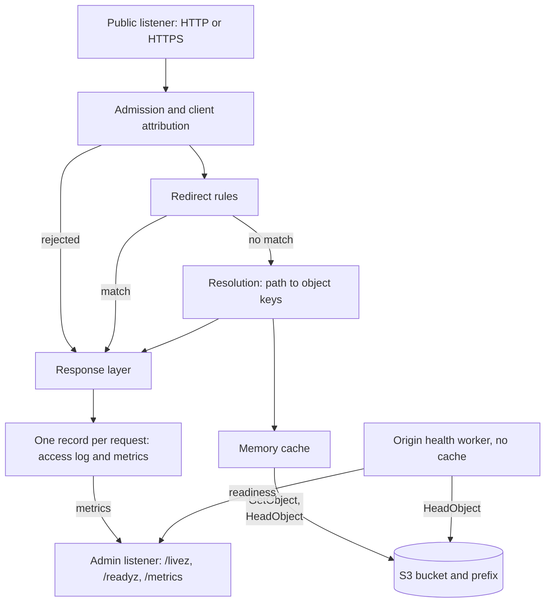

# Architecture overview

**statica** is one process that serves one S3 bucket, or one prefix inside it, as one website. This page shows its components, follows one request through them and states the principles behind the design. The other Architecture pages describe each mechanism in detail. For what statica offers and where it fits in a deployment, start with [What is statica?](../guide/what-is-statica.md).

## Components

The diagram shows the components a request meets, and the admin side that runs next to them.

## The life of a request

These steps follow a `GET /guide/` that finds nothing in the memory cache. Every step before the sixth is local: a request that is rejected or redirected there never reaches the memory cache or the origin.

1. **Accept.** The public listener accepts the connection on `server.listen`, over cleartext HTTP/1.1 or, with `server.tls`, over HTTPS with HTTP/1.1 and HTTP/2 ([Serve HTTPS directly](../guide/tls.md)).
2. **Attribute.** statica determines the client IP and the request ID. It uses a forwarded client IP and a proxy's request ID only when the connecting peer is in `server.trusted_proxies` ([client IP attribution](./security.md#trusted-proxies-and-client-ip-attribution)).
3. **Admit.** The request takes a request slot, or gets 503 Service Unavailable at once. Its host, its method and its target are then checked, and a request that fails a check gets a generated response ([the request pipeline](./request-flow.md#the-request-pipeline)).
4. **Redirect.** The `redirects` rules, compiled at startup, are evaluated in order. The first rule that matches answers with its status and `Location`, without reading the origin ([redirect rules](./request-flow.md#redirect-rules)).
5. **Resolve.** The path becomes an object key under the publication prefix, here `guide/index.html`. Resolution tries a fixed order of candidates: the object, its index object, the single-page-app shell when `spa` is configured, and the `not_found` object ([from path to object](./request-flow.md#from-path-to-object), [SPA fallback](./spa-fallback.md)). With `compression.mode: precompressed`, it also looks for `.br` and `.gz` variants ([Precompressed variants](./precompressed-variants.md)).
6. **Look up.** Each candidate is read through the memory cache. It holds no usable copy of this key, so the request starts a shared fill, which concurrent requests for the same key join instead of reading the origin themselves ([shared fills](./memory-cache.md#shared-fills)).
7. **Read the origin.** The fill sends one `GetObject` with credentials from the standard AWS credential chain, in at most `s3.max_attempts` attempts and without following redirects. Only a confirmed absence lets resolution try the next candidate: a 403 Forbidden is a denial, and any other failure is an error response, never a fallback ([only a confirmed absence continues](./request-flow.md#only-a-confirmed-absence-continues), [Access denied](./access-denied.md)).
8. **Store.** The fill keeps the object in memory when it fits the cache's limits, and streams it to the request otherwise ([limits and accounting](./memory-cache.md#limits-and-accounting)).
9. **Respond.** The response layer evaluates conditional headers and a byte range against the selected object, sets `Content-Type`, the validators, `Cache-Control` and `Age`, and streams the body, bounded by inactivity limits instead of a total duration ([Ranges and conditional requests](./ranges-and-conditionals.md), [Cache-Control and Age](./cache-control.md), [Timeouts and long downloads](./timeouts.md)). Every response, errors and redirects included, carries `X-Request-ID`, `X-Content-Type-Options: nosniff`, the headers of `headers.set` and the CORS grant when one applies.
10. **Record.** When the request ends, one record goes to the access log, as an `http_request` event, and to the Prometheus metrics, so both describe the same request ([Log reference](../reference/logs.md), [Metrics reference](../reference/metrics.md)).

The next request for `/guide/` stops at step 6: the memory cache answers it from memory until the entry expires, then checks the entry against the origin ([freshness](./memory-cache.md#freshness), [revalidation](./memory-cache.md#revalidation)). With [`cache.enabled`](../reference/configuration.md#cache-enabled) set to `false`, there is no memory cache and resolution reads the origin directly.

## Beside the request path

- **The admin listener** is a separate cleartext HTTP/1.1 server on `admin.listen`, with its own limits. It answers `/livez`, `/readyz` and `/metrics` without authentication, so bind it to a loopback or private address ([Admin endpoints reference](../reference/admin-endpoints.md)).
- **The origin health worker** is optional. When `admin.origin_health` is enabled, it periodically sends a single-attempt `HeadObject` for one key through its own S3 client, without the memory cache, and feeds the result into readiness ([origin health](./lifecycle.md#origin-health)).
- **Startup and shutdown.** Every component is built before any listener is bound, and a shutdown drains requests inside one time budget ([Startup, readiness and shutdown](./lifecycle.md)).

## Design principles

- **One site per instance.** A configuration has one `s3` block: one bucket and an optional publication prefix. To serve several sites, run one instance per site.
- **Host never selects the origin.** The hostname is used for admission and telemetry only: it is never part of an S3 request, an object key or a memory cache entry ([Security model](./security.md#host-never-selects-the-origin)).
- **Configuration is immutable.** statica validates its configuration and builds every component before it opens a socket, and nothing is reloaded: restart the process to apply a change.
- **Every resource has a ceiling.** Connections, concurrent requests, request size, cache memory, shared fills and each phase of a request have a configured limit, and statica refuses work instead of queueing it ([request capacity](./request-flow.md#request-capacity), [cache limits](./memory-cache.md#limits-and-accounting), [time limits](./timeouts.md#the-limits)). These limits are ceilings that you choose, not measured capacities.
- **The origin is the source of truth.** statica reads the bucket with `GetObject` and `HeadObject` only, and never lists, writes or deletes objects. The memory cache holds copies of origin responses and checks them against the origin when they expire.
- **A failure never looks like a page.** An origin failure is answered with an error status, or with an expired copy when [`cache.stale_if_error`](../reference/configuration.md#cache-stale-if-error) allows it, never with an index, single-page-app or custom 404 page.
