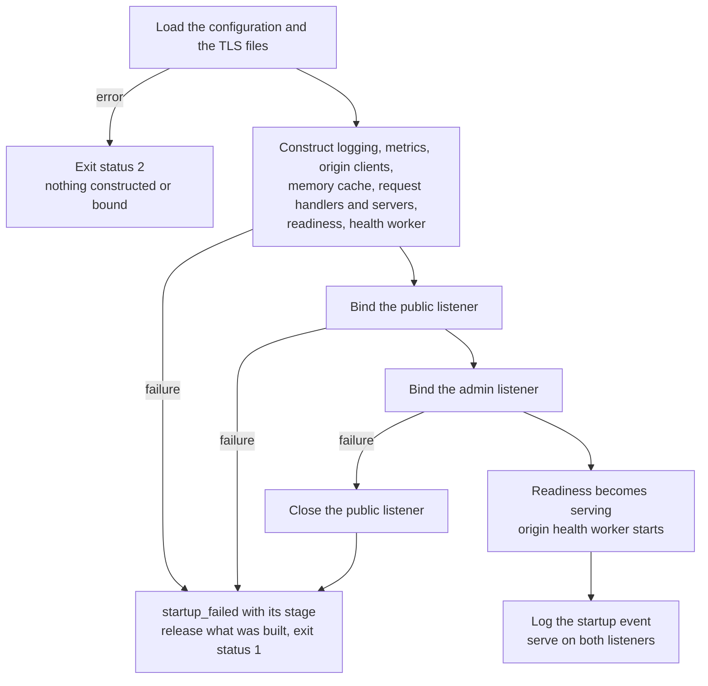
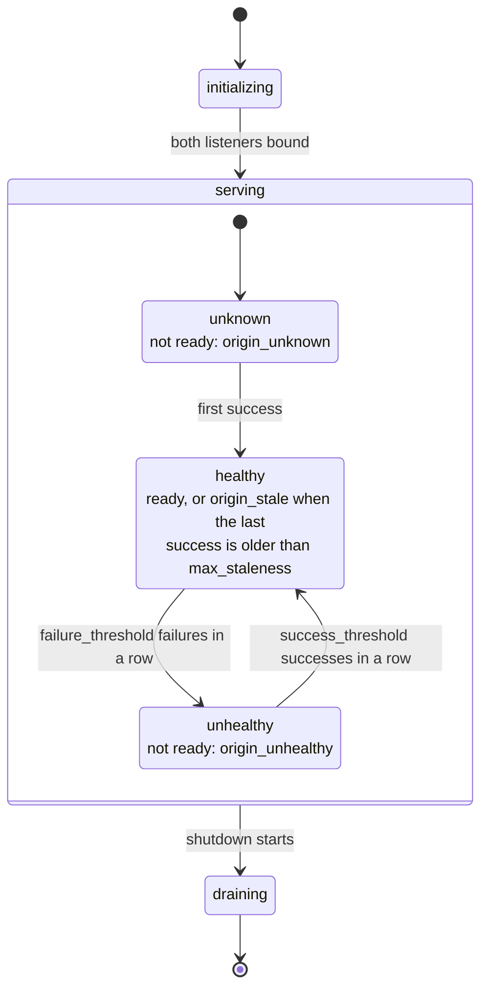

# Startup, readiness and shutdown

`statica serve` checks its configuration before anything starts, constructs every component before it binds a listener, and reports readiness only once both listeners are bound. Readiness then follows the process phase and, when you enable it, a background origin health check; liveness stays local to the process. A shutdown runs inside one time budget, `server.shutdown_timeout`, and keeps the admin listener up until the end so that orchestrators can watch the drain. This page describes each phase, the events it logs and the exit status it ends with. [Deploy, roll out and shut down](../guide/deployment.md) applies it to systemd and Kubernetes.

## Startup

The startup sequence runs in a fixed order, and each failure ends it before the next step:



### Checks before anything starts

`serve` selects one configuration file, loads it, validates it and reads the TLS certificate and key named by `server.tls`, if any. An error at this point prints `statica: <message>` on standard error and exits with status 2: no origin client is created, the AWS configuration is not loaded and no listener is bound. `statica config validate` runs the same checks, so it predicts this step.

### Construct, then bind

Every component is constructed before any listener is bound, in this order: logging and its output queue, metrics, the origin client, a second origin client dedicated to the origin health check (only when `admin.origin_health.enabled` is `true`), the memory cache, the content handler, the public handler and server, readiness, the origin health worker and the admin server.

Creating an origin client loads the AWS configuration: it sets up the credential chain and, when `s3.region` is not set, finds the region. That step is bounded by `server.response_header_timeout`, the budget that `statica config check-origin` also uses for its origin access. It does not fetch credentials and sends no request to the bucket. Missing or invalid credentials, a wrong bucket name or a missing permission therefore show up only on the first request, in the origin health check when it is enabled, or with `statica config check-origin`. Without `admin.origin_health`, such an instance still becomes ready. The startup fails with `stage=origin_client` only when the AWS configuration cannot be loaded in time, for example because no region can be found or a named profile does not exist.

A construction failure logs `startup_failed` at error level with a `stage` field, releases what was built so far, prints a fixed message on standard error (never a provider error or an endpoint) and exits with status 1. Nothing is ever bound.

| `stage` | What failed |
| --- | --- |
| `metrics` | The metrics registry |
| `origin_client` | Loading the AWS configuration, for example a missing profile, and finding the region |
| `health_client` | The same, for the dedicated origin health client |
| `cache` | The memory cache |
| `content` | Object resolution and responses |
| `public_handler` | Request admission: host, method, target, CORS and redirect rules |
| `public_server` | The public server, including loading the TLS certificate and key |
| `health_worker` | The origin health worker |
| `admin_server` | The admin server |
| `bind_public` | Binding `server.listen` |
| `bind_admin` | Binding `admin.listen` |

### Binding the listeners

Both listeners are bound synchronously, the public listener (`server.listen`) first, then the admin listener (`admin.listen`). If the admin bind fails, the public listener is closed before `startup_failed stage=bind_admin` is logged, so a failed start never leaves a listener open. Standard error then reads, for example:

```text
statica: cannot bind the admin listener
```

### Readiness and the startup event

Only after both binds does readiness become `serving` and the origin health worker start, so readiness is never claimed on elapsed time. The [`startup`](../reference/logs.md#startup) event follows, at info level. It reports the resolved, non-secret operating mode:

- the build: `version`, `revision` and `go_version`;
- the addresses actually bound, `public_listen` and `admin_listen`;
- TLS (`tls=on` or `off`, with `tls_min_version`), host admission (`hosts=any`, or `hosts=allowlist` with `hosts_count`) and the number of `trusted_proxies`;
- the public server's timeouts and limits;
- the origin: `s3_endpoint=aws` or `custom`, the resolved `s3_region`, the S3 switches, timeouts and `s3_max_attempts`;
- the memory cache (`cache=on` or `off`, with its limits and TTLs when on), compression, SPA fallback and origin health modes;
- the logging settings `access_log`, `log_client_ip` and `log_level`.

The `startup` event never contains the bucket, the prefix, the endpoint address, host names, credentials or key material. When `s3.insecure_skip_verify` is `true`, a second event, `origin_tls_verification_disabled`, follows at warn level.

### A signal during startup

The signal handlers are installed as soon as the process starts; a signal that arrives before that ends the process with the signal's default action. After that, a SIGINT or SIGTERM received before both listeners are bound aborts the startup: loading the AWS configuration, if still in progress, is canceled, no listener stays bound, what was built is released, `startup_aborted reason=signal` is logged at info level, the logs are flushed and the process exits with status 0.

A genuine failure takes precedence over a signal that arrives at the same time. If a component or a bind fails while a signal is pending, `startup_failed stage=… signal_pending=true` is logged and the process exits with status 1, so a supervisor never mistakes a failed start for a requested stop.

## Readiness and liveness

The admin listener answers two probes from in-memory state. Neither probe ever contacts the origin. The [admin endpoints reference](../reference/admin-endpoints.md) describes the responses, and [Health checks and readiness](../guide/health-checks.md) how to wire them to probes.

### Liveness

`/livez` answers 200 OK with the body `ok` for as long as the admin listener runs: during origin outages, while readiness is false and throughout the drain. It does not consult readiness or the origin health check. It stops answering only when the admin listener itself shuts down, near the end of a shutdown.

### Readiness phases and reasons

`/readyz` answers 200 OK with `ready`, or 503 Service Unavailable with `not ready: <reason>`. The process phase only advances: `initializing`, then `serving` once both listeners are bound, then `draining` once a shutdown starts. Without origin health, `serving` means ready.

When several reasons apply, `/readyz` reports the first one in this table: phase reasons take precedence over origin reasons, and `origin_unhealthy` over `origin_stale`.

| Reason | When |
| --- | --- |
| `initializing` | Components are being constructed or the listeners bound |
| `draining` | A shutdown has started |
| `origin_unknown` | Origin health is enabled and no check has succeeded yet |
| `origin_unhealthy` | `admin.origin_health.failure_threshold` consecutive checks failed and the origin has not recovered |
| `origin_stale` | The last successful check is older than `admin.origin_health.max_staleness` |

The admin listener starts answering only after readiness has become `serving`, so probes never observe `initializing`. The [`statica_ready`](../reference/metrics.md#statica-ready) gauge reports the same decision at scrape time; the reason is never a metric label.

### Origin health

With `admin.origin_health.enabled: true`, one background worker checks that the origin can still serve the site. Its state, and the readiness reason it produces, move like this:



The rules:

- **One check at a time.** The worker starts after both listeners are bound and runs its first check at once. Each check is one `HEAD` request for the publication prefix followed by `admin.origin_health.key` (by default, the value of `index`). Checks never overlap.
- **One attempt, no cache.** The check uses its own origin client, built with a single attempt whatever `s3.max_attempts` says, and never reads or fills the memory cache. Each check runs under its own `admin.origin_health.timeout`. The origin metrics count these requests under `purpose="health"`.
- **Interval and jitter.** The next check starts `admin.origin_health.interval` after the previous one ended, less a random jitter of up to 10% of the interval, so the wait is between 0.9 × `interval` and `interval`. Subtracting the jitter spreads instances that share an origin while keeping two successes of a healthy origin at most `interval` + `timeout` apart. Configuration validation requires `timeout` to be less than `interval` and `max_staleness` to exceed `interval` + `timeout`.
- **Raw results.** Only a `HEAD` that returns the object's metadata is a success. Every other result is a failure, classified before the public access-denied masking: a raw 403 Forbidden counts as `denied` even when visitors receive a 404 Not Found. A 404 answer to a `HEAD` has no body to confirm that the key is missing, so on providers that answer 404, and on AWS with `s3:ListBucket`, a missing health key is reported as `ambiguous_not_found`; unlike `statica config check-origin`, the check does not retry it with a `GET`. On AWS without `s3:ListBucket`, the origin answers 403 and a missing key is reported as `denied` ([AWS without `s3:ListBucket`](./access-denied.md#aws-without-s3-listbucket)). The other results are `throttled`, `unavailable`, `configuration`, `timeout` and `failed`.
- **The first success alone makes the origin healthy.** `admin.origin_health.success_threshold` applies only to recovery: after `failure_threshold` consecutive failures make a healthy origin unhealthy, `success_threshold` consecutive successes make it healthy again. Failures before the first success keep the origin unknown.
- **Staleness is judged at read time.** Each `/readyz` request and each scrape compares the time of the last success with `max_staleness`. The worker does not have to report anything, so a stopped or stuck worker cannot keep an instance ready.
- **Shutdown does not count.** A check cut short because the process is shutting down is not recorded: it says nothing about the origin.

Two events report the worker's view:

- `origin_health_changed` with `state`, `previous` and `result`, on every state change: at error level when the origin becomes `unhealthy`, at info level otherwise.
- `origin_health_check_failed` with `state=unknown` and `result`, at warn level, for failures before the first success, once per change of result rather than at every check.

A failure that does not change the state, after the first success, logs nothing; it is counted in `statica_origin_health_checks_total` by `result`, next to `statica_origin_health_last_success_timestamp_seconds` ([readiness and origin health metrics](../reference/metrics.md#readiness-and-origin-health)).

#### Timing with the defaults

With the default `interval` of `30s`, `timeout` of `3s`, `failure_threshold` of `3`, `success_threshold` of `1` and `max_staleness` of `90s`:

- **At startup**, the first check runs as soon as both listeners are bound, so a healthy origin makes the instance ready within that check's duration, at most 3 s. If the first check fails, the next one starts 27 to 30 s after it ended.
- **When the origin breaks** right after a successful check, checks that fail fast reach the third failure between about 81 s and 90 s later (`origin_unhealthy`). Checks that time out take 3 s each, so their third failure completes between about 90 s and 99 s later, but the last success becomes stale at 90 s first (`origin_stale`). Either way, readiness is false at most 90 s after the last success.
- **When the origin recovers**, the next check succeeds and, with `success_threshold` at `1`, makes the instance ready again: within about 33 s, one interval plus one timeout.

Your orchestrator's probe period adds to these times.

### Readiness does not gate public requests

The public listener serves every request it receives, whatever readiness says. While the origin is unhealthy, for example, fresh content in the memory cache is still served and requests that need the origin can fail. Readiness is a signal for your orchestrator or load balancer, which decides where to send traffic.

## Shutdown

### What starts a shutdown

The first SIGINT or SIGTERM received while serving starts a graceful shutdown, logged as `shutdown_started reason=signal` with the `shutdown_timeout` in force. An unexpected failure of either listener starts one too: `listener_failed` is logged at error level with `listener=public` or `listener=admin`, followed by `shutdown_started reason=listener_failure` (see [listener failures](#listener-failures)).

### One budget

The whole shutdown runs inside one budget `B = server.shutdown_timeout`, measured from the moment it starts. A tail `T = min(B/4, 1s)` at the end of the budget is reserved for logging the canceled requests, stopping the admin listener and flushing the logs. With the default budget of `30s`, `T` is 1 s. In the worst case, when every step uses its full allowance, the shutdown unfolds like this:

```mermaid
gantt
  accTitle: Shutdown timeline with the default 30 s budget
  accDescr: With server.shutdown_timeout at 30 s, the tail T is 1 s. At 0 s readiness becomes draining while the admin listener keeps answering probes. The public drain runs until 29 s, when the requests still active are canceled. Canceled requests unwind until 29.5 s, the admin listener shuts down by 29.75 s, and shutdown_complete and the log flush end by 30 s. Each step ends earlier when it has nothing left to wait for.
  dateFormat x
  axisFormat %-S s
  tickInterval 5second
  todayMarker off
  section Public
    Drain active requests, until 29 s : 0, 29000
    Cancel requests still active, at 29 s : milestone, 29000, 0ms
    Unwind canceled requests, until 29.5 s : 29000, 29500
  section Admin
    Answer probes, readyz reports draining : 0, 29500
    Shut down, until 29.75 s : 29500, 29750
  section Logs
    shutdown_complete and flush, until 30 s : 29750, 30000
```



| Step | Deadline | Default | What happens |
| --- | --- | --- | --- |
| 1 | At once | 0 s | Readiness becomes `draining`: `/readyz` answers 503 `not ready: draining` and `/livez` still answers 200. `shutdown_started` is logged. |
| 2 | `B − T` | 29 s | The public listener stops accepting connections and lets active requests finish. The origin health worker stops; a check in progress is canceled and not counted. At the deadline, the requests still active are counted and canceled, and their connections are closed. |
| 3 | After step 2 | 29 s | The memory cache's lifetime ends, which stops its shared fills. This happens only after the public server has canceled its requests, so a draining request never fails because a fill it waits on was canceled first. |
| 4 | `B − T/2` | 29.5 s | The shutdown waits for the canceled requests to unwind, so that their `http_request` events are logged. |
| 5 | `B − T/4` | 29.75 s | The admin listener, which stayed up so that orchestrators could see the drain, shuts down, also within its own 5 s limit. The origin clients close their idle connections. |
| 6 | `B` | 30 s | `shutdown_complete` is logged and the log output is flushed in the time left, normally at least `T/4`. If an earlier step runs to the end of the budget, queued lines can be lost. |

The deadlines are upper bounds: when the drain finishes early, the next steps follow at once. Every step is bounded even when a request handler or the origin ignores cancellation, so the process exits within the budget plus scheduling delays.

[`shutdown_complete`](../reference/logs.md#shutdown-complete) carries the `reason`, the `outcome` and `duration_ms`:

- `outcome=drained`, at info level, when every request finished in time;
- `outcome=forced`, at warn level, when the drain was cut short or did not take place, with `forced_by` and `cancelled_requests`, the number of requests still active at that point. `forced_by` is `budget` or `signal` as described above, `listener_failure` when a failed public listener had already closed every public connection (the count is then best effort), or `error` when the drain ended with an error other than its deadline.

::: warning The public listener closes at once
The public listener stops accepting new connections as soon as the shutdown starts; it does not wait for load balancers to notice that readiness turned false. If your load balancer keeps sending new connections to the instance for a while after it becomes unready, delay the signal itself, for example with a pre-stop step in your orchestrator.
:::

::: tip Give the process enough time
Set your process manager's grace period, the time between its stop signal and a forced kill, longer than `server.shutdown_timeout`, so that the drain and the final log flush can complete.
:::

### Long downloads

The drain deadline applies to every request, whatever its own duration limits: even with `server.request_timeout` at `0s` (no total limit), a download still running at `B − T` is cut. Its `http_request` event, at warn level, shows the status already sent, `outcome=incomplete` and `termination_reason=shutdown`. If a long download must be able to finish, raise `server.shutdown_timeout`.

### A second signal

Any SIGINT or SIGTERM received while the shutdown runs forces an immediate close: both listeners and their connections close, every remaining step is canceled, and the log output gets at most 250 ms to flush what fits. `shutdown_complete` reports `outcome=forced forced_by=signal` with `cancelled_requests`, the number of requests still active.

::: warning Events lost to a forced close
A forced close skips the wait for canceled requests to unwind and gives the log output at most 250 ms. The `http_request` events of the requests it cuts, and any other lines that do not fit in that time, can be missing from the logs.
:::

### Listener failures

When a listener fails unexpectedly while serving, it closes its own connections at once, so requests in progress on a failed public listener are cut, and `shutdown_complete` reports `outcome=forced forced_by=listener_failure` with a best-effort `cancelled_requests`: requests that already ended are not counted. A failed admin listener does not affect public requests, which drain as usual. The shutdown that follows runs through the same steps, and the process exits with status 1. A listener that fails while a shutdown is already running is logged as `listener_failed` too, but the exit status still follows the cause of the shutdown.

### Exit status

| How the process ends | What is logged | Exit status |
| --- | --- | --- |
| A signal, and every request finished | `shutdown_complete outcome=drained` | 0 |
| A signal, and requests were cut by the budget or a second signal | `shutdown_complete outcome=forced` (warn) | 0 |
| A signal during startup, with no failure | `startup_aborted reason=signal` | 0 |
| A construction or bind failure, even with a signal pending | `startup_failed stage=…`, with `signal_pending=true` when a signal was pending | 1 |
| An unexpected listener failure | `listener_failed`, then `shutdown_started reason=listener_failure` and `shutdown_complete` | 1 |
| An invalid configuration, invalid TLS files or a usage error | Nothing; a message on standard error | 2 |

An exit status of 0 after a forced shutdown is deliberate: the stop was requested, and the warn-level `shutdown_complete` says that it cut requests short.

## Configuration changes and restarts

The configuration file and the TLS certificate and key are read only at startup, before any listener is bound. Nothing is reloaded while the process runs: to apply a configuration change or a renewed certificate, restart the process, one instance at a time if you run several.

The memory cache lives in the process's memory, so a restarted instance starts with an empty cache and reads every object from the origin again until the cache warms up.

::: warning SIGHUP does not reload
Only SIGINT and SIGTERM are handled. Any other signal that stops the process, such as SIGHUP or SIGKILL, stops it without a drain, without the shutdown events and without flushing the log output. A standard output whose reader has gone away does not stop the process: **statica** keeps serving, and the log lines it cannot write are dropped and counted in [`statica_log_events_dropped_total`](../reference/metrics.md#statica-log-events-dropped-total).
:::

## What statica does not do

- It does not reload configuration or certificates, on SIGHUP or otherwise.
- It does not fetch credentials or check the bucket at startup: use the origin health check or `statica config check-origin` for that.
- It does not hold back public requests while it is not ready.
- It does not verify the whole site: the origin health check reads the metadata of one object.
- It does not wait before closing the public listener when a shutdown starts.
- It does not keep the memory cache across restarts.

## Related pages

- [Security model](./security.md): the admin listener, trusted proxies and safe logging.
- [Timeouts and long downloads](./timeouts.md#shutdown-cuts-long-downloads): how the drain deadline interacts with a request's own limits.
- [Access denied](./access-denied.md#origin-health-check): how a denied origin shows in the origin health check.
- [Configuration reference](../reference/configuration.md): defaults and limits of [`server.shutdown_timeout`](../reference/configuration.md#server-shutdown-timeout) and [`admin.origin_health`](../reference/configuration.md#admin-origin-health).
- [CLI reference](../reference/cli.md#statica-serve): `statica serve`, its signals and its exit status.
- [Deploy, roll out and shut down](../guide/deployment.md) and [Health checks and readiness](../guide/health-checks.md): probes, grace periods and rollouts in practice.
- [Admin endpoints reference](../reference/admin-endpoints.md): `/livez`, `/readyz` and `/metrics`.
- [Log reference](../reference/logs.md#events): the fields of every lifecycle event.
- [Metrics reference](../reference/metrics.md#readiness-and-origin-health): the readiness and origin health series.
