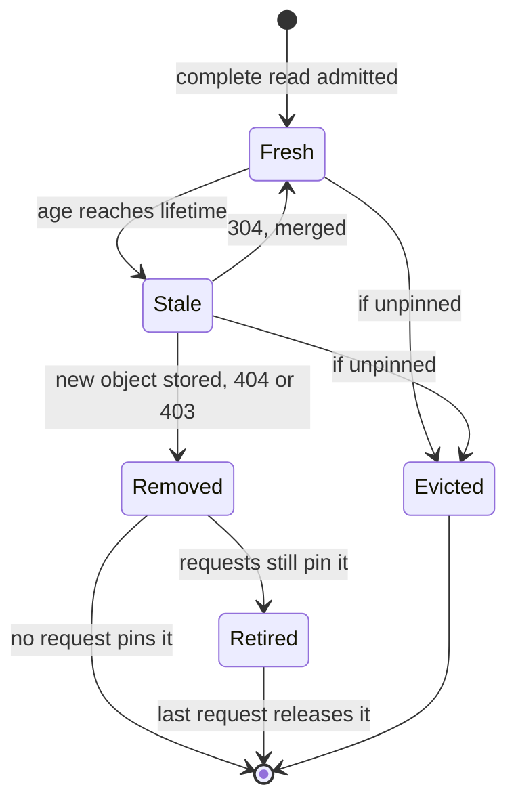
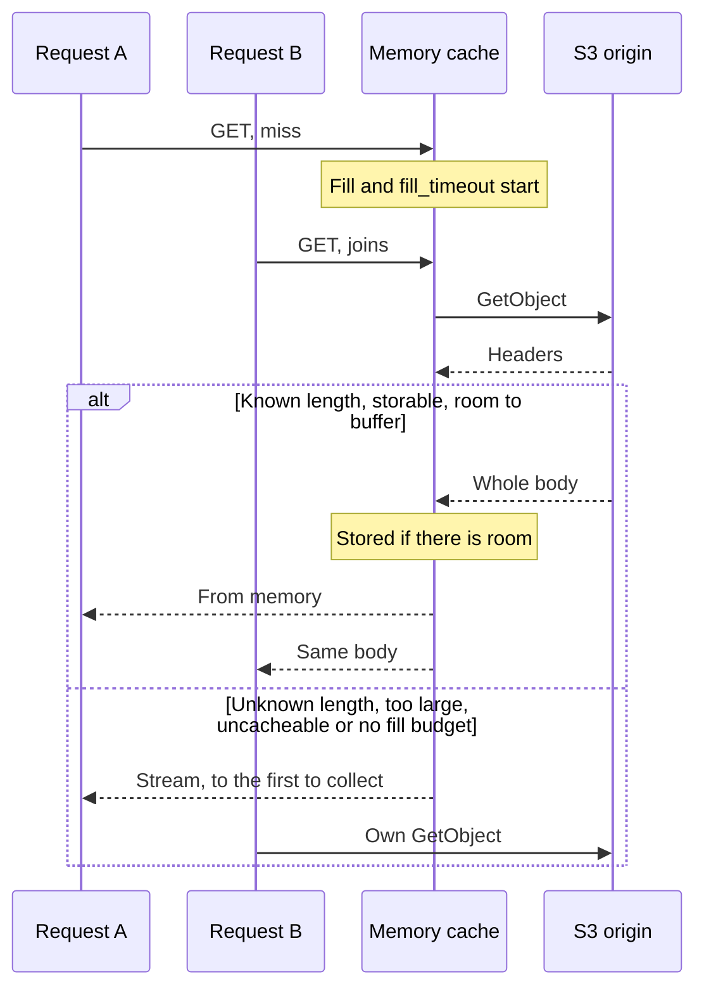
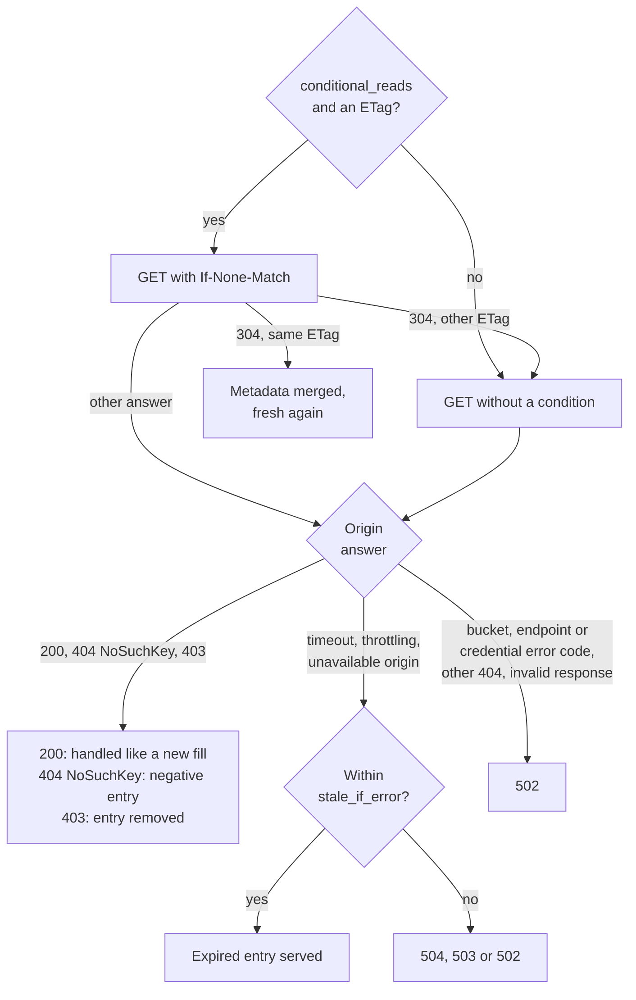

# Memory cache

A bounded in-memory cache keeps copies of origin responses, so that repeated requests for the same object do not all reach the origin. This page explains what an entry is, how memory is accounted and reclaimed, how concurrent requests share one origin read, when an entry is fresh, how **statica** revalidates it, and when a request bypasses the cache. The [`cache`](../reference/configuration.md#cache) block configures it. With [`cache.enabled`](../reference/configuration.md#cache-enabled) set to `false` there is no memory cache, and every read goes to the origin.

The memory cache decides what statica stores. What browsers and CDNs are told to store is a separate policy, described in [Cache-Control and Age](./cache-control.md). To size and tune the cache for a site, see [Tune the memory cache](../guide/cache-tuning.md).

## Identity of an entry

An entry is identified by its exact S3 object key: the publication prefix, the object path and, for a precompressed variant, its `.br` or `.gz` suffix. One process serves one bucket and prefix, so the key alone identifies the object.

These are not part of an entry's identity: the `Host` header, the client IP, the query string, `Range` and conditional headers, `Accept`, `Accept-Encoding` and every other request header. `Accept-Encoding` only decides which variant key resolution reads. Every hostname, client and query that maps to the same object key shares one entry: for example, every route answered with the single-page-app shell uses the shell's single entry.

An entry holds what the origin returned, the body bytes and the object's metadata (type, length, validators, cache headers, encoding, disposition and language), never a finished response. The status, the `Cache-Control` sent to the client, CORS headers, `Vary` and the request ID are computed for each request, and each request evaluates its own conditions and range against the entry.

## Entry kinds

- **Body** entries hold the complete bytes and metadata of an object. They answer `GET`, `HEAD` and range requests.
- **Metadata** entries hold the result of a metadata read from the origin, made for a `HEAD` request or a range request. They answer `HEAD` requests and give range requests the metadata they are decided on, but never a body: a `GET` that needs the body reads it, and the body entry it stores replaces the metadata entry.
- **Negative** entries record that the origin confirmed the key missing. While they are fresh, they answer `GET` and `HEAD` requests for the key as missing without an origin read.

All three kinds count toward the same limits. Nothing else is stored: no partial content, no error answer and no 403 answer.

## Life of an entry

The diagram shows how an entry changes from its admission until statica frees its memory.



- Nothing removes an entry when it expires. A stale entry stays in memory, and stays charged, until a request revalidates or replaces it or eviction removes it. `statica_cache_expirations_total` counts the entries that a lookup found expired.
- A request can also force the revalidation of a fresh entry (see [request directives](#request-directives)). The revalidation then has the same outcomes as for a stale entry.
- A changed object replaces the entry with a new body entry, a confirmed absence replaces it with a negative entry, and an access denial removes it without storing anything. [Revalidation](#revalidation) has the details.
- Metadata entries expire the same way; the next `HEAD` or range request then reads the origin's metadata again and replaces them (see [HEAD requests](#head-requests)). Negative entries live for [`cache.negative_ttl`](../reference/configuration.md#cache-negative-ttl) (see [negative entries](#negative-entries)).

## Limits and accounting

[`cache.max_bytes`](../reference/configuration.md#cache-max-bytes) and [`cache.max_entries`](../reference/configuration.md#cache-max-entries) bound the memory cache together: an entry is admitted only when both limits still hold afterward. Each entry is charged a fixed overhead of 640 bytes, plus the lengths of its key and of its metadata strings, plus its body bytes. Metadata and negative entries have no body but pay the same overhead, so many small entries can reach `max_entries` before `max_bytes`.

[`cache.max_object_bytes`](../reference/configuration.md#cache-max-object-bytes) is the largest body that a shared fill buffers and stores. [`cache.max_fill_bytes`](../reference/configuration.md#cache-max-fill-bytes) bounds the memory reserved for bodies that shared fills are downloading. Configuration validation requires `max_object_bytes` to be no larger than `max_bytes` and `max_fill_bytes`. These limits are process-wide: [`cache.rules`](../reference/configuration.md#cache-rules) cannot change them.

### Pinned and retired entries

A request that serves a body from memory pins its entry until its response ends: the body is written directly from the stored bytes, without copying them. Eviction never removes a pinned entry.

When an entry leaves the index while requests still pin it, for example because a newer copy replaced it or the origin denied access, it is retired. Later lookups no longer find it, but it stays charged to `max_bytes` and `max_entries` until the last request reading it finishes. `statica_cache_retired_bytes` reports the retired part of `statica_cache_bytes`.

### What the budget does not cover

The limits bound the memory cache, not the process:

- Bodies that shared fills are downloading are charged to `max_fill_bytes`, which is separate from `max_bytes`. So is a complete body that could not be admitted, for as long as requests still read it.
- A streamed response uses a fixed 32 KiB buffer, outside both budgets.
- The Go runtime, connections, TLS, metrics and the log queue need memory of their own.

Give the process memory beyond `max_bytes` plus `max_fill_bytes` ([Leave room for the rest of the process](../guide/cache-tuning.md#leave-room-for-the-rest-of-the-process)).

## Admission and eviction

Entries are kept in least recently used order: every lookup that finds an entry marks it as the most recently used. When a new entry does not fit, the eviction is planned before anything changes:

1. It walks the entries from the least recently used, counting only those that no request pins.
2. It stops as soon as evicting the counted entries would make room for the new one under both `max_bytes` and `max_entries`.
3. Only then does it evict those entries, and it moves the pinned entries it walked past to the most recently used end.

If evicting every unpinned entry would still not make room, nothing is evicted and the new entry is not stored: the admission result is `no_space`. An entry whose charge alone exceeds `max_bytes` is refused as `too_large`. A refused admission does not fail any request: the requests that were waiting for the entry are still served from the bytes already read.

`statica_cache_admissions_total` counts admission results, such as `admitted`, `replaced`, `refreshed`, `too_large` and `no_space`. `statica_cache_evictions_total` counts capacity evictions by entry kind; replacements and removals are not evictions.

## Shared fills

When a `GET` finds no usable entry for a key (no entry, a stale body, a stale negative entry, or only a metadata entry), it starts a shared fill: one origin read for that key, made on behalf of every request that needs it. Requests for the same key that arrive while the fill runs join it as waiters instead of reading the origin. A fill revalidates a stale body when it can (see [revalidation](#revalidation)), and fetches the object otherwise.

The sequence shows two requests for the same object key.



### Fill limits

- [`cache.max_concurrent_fills`](../reference/configuration.md#cache-max-concurrent-fills) bounds the shared fills running at once, including fills that every waiter has left but that are still stopping. When it is reached, a request that would start a new fill reads the origin directly, alone, and nothing is stored: its cache outcome is `bypass` with reason `fills_full`.
- [`cache.max_waiters_per_key`](../reference/configuration.md#cache-max-waiters-per-key) bounds the requests waiting on one fill. A request beyond it reads the origin directly, with reason `waiters_full`.
- A request that joined a fill another request started is logged with `cache_coalesced=true` and counted as `outcome="coalesced"` in `statica_cache_requests_total`.

### Deadlines and cancellation

A shared fill belongs to no single request:

- Its own deadline, [`cache.fill_timeout`](../reference/configuration.md#cache-fill-timeout), starts with the fill and is never extended by requests that join later. It does not depend on [`server.request_timeout`](../reference/configuration.md#server-request-timeout), so a fill stays bounded even when requests have no total time limit. A fill that completes at or after its deadline counts as timed out.
- Each waiter keeps its own deadlines: [`server.response_header_timeout`](../reference/configuration.md#server-response-header-timeout) and, when it is set, `server.request_timeout`. A waiter whose deadline passes, or whose client disconnects, leaves with its own error, and the fill continues for the other waiters.
- When the last waiter leaves a fill that has not finished, the fill is canceled, and the next request for the key starts a new one.
- When the process shuts down, unfinished fills are canceled, and their waiters get 503 Service Unavailable.

When a fill times out, each request still waiting for it gets 504 Gateway Timeout with `termination_reason=preparation_timeout`, unless [stale-if-error](#stale-if-error) serves an expired copy. `statica_cache_fill_duration_seconds{result="timeout"}` counts fills that ended this way, whether `cache.fill_timeout` or an origin timeout inside the fill ended them.

Apart from the refetch after a 304 with another `ETag` (see [revalidation](#revalidation)), a fill makes no retry of its own: each origin operation makes up to [`s3.max_attempts`](../reference/configuration.md#s3-max-attempts) attempts, as any other origin read does.

### Buffered or streamed

The fill decides from the origin's response headers, before it reads the body:

- An object with a known length up to `cache.max_object_bytes`, whose metadata may be stored, is buffered. The fill reserves exactly its length from `cache.max_fill_bytes`, reads the whole body, checks that the length matches and that any checksum the origin sent was verified (with [`s3.features.checksums`](../reference/configuration.md#s3-features-checksums)), and only then admits it. Every waiter is served from that one stored body. Because the body is read completely first, the waiters receive their first byte only after the whole object has arrived.
- Otherwise the origin stream is handed to the first waiter that collects the fill's result, and every other waiter reads the origin directly. The bypass reason says why: `unknown_size` (the origin sent no length), `too_large` (above `max_object_bytes`), `uncacheable` (the origin metadata may not be stored) or `fill_budget` (other fills hold `max_fill_bytes`). Once handed over, the stream belongs to that request alone: neither `cache.fill_timeout` nor the end of the fill cuts a long download, which only the request's own limits bound.

A body that ends early, runs long, fails while being read, fails its checksum or completes after the fill's deadline is never stored, and the waiters get an error.

## Freshness

### Lifetime

The lifetime of a body or metadata entry combines the object's effective [`cache.ttl`](../reference/configuration.md#cache-ttl) with the origin's own freshness lifetime: `s-maxage`, else `max-age`, else `Expires` minus the origin's `Date`, and zero with `Cache-Control: no-cache`. When the origin assigns no lifetime, the entry lives for the `ttl`. When it assigns one, the object's effective [`cache.ttl_mode`](../reference/configuration.md#cache-ttl-mode) gives the `ttl` its role: an upper bound (`ceiling`), a lower bound (`floor`), a value used only without an origin lifetime (`fallback`), or the lifetime itself (`fixed`).

With `ttl: 5m`:

| Origin metadata | `ceiling` | `floor` | `fallback` | `fixed` |
| --- | --- | --- | --- | --- |
| none | 5 minutes | 5 minutes | 5 minutes | 5 minutes |
| `max-age=60` | 1 minute | 5 minutes | 1 minute | 5 minutes |
| `max-age=3600` | 5 minutes | 1 hour | 1 hour | 5 minutes |
| `no-cache` | zero | 5 minutes | zero | 5 minutes |

An entry with a zero lifetime is stored, but every reuse revalidates it first: an origin `no-cache` gives one with `ceiling` or `fallback`, and a `ttl` of `0s` with `ceiling` or `fixed`.

::: warning
With `floor` or `fallback`, the origin's metadata can keep an object fresh far longer than its `ttl`. With `max-age=31536000`, statica can serve its copy for a year without asking the origin: a changed object may not reach clients until a request forces a revalidation, the entry is evicted or the instance restarts.
:::

An entry is fresh while its age is below its lifetime. With `ceiling`, `floor` and `fallback`, its age is the current age that RFC 9111, section 4.2.3 defines. Take the larger of two values: the time from the origin's `Date` to the arrival of the response, and the origin's `Age` plus the request's round trip. Then add the time since the response arrived. With `fixed`, which ignores the origin's freshness altogether, its age is the time since the response arrived, so the origin's `Date` and `Age` cannot shorten its freshness. In every mode, a revalidation restarts the age, and the `Age` header of a response states the RFC 9111 current age ([Age](./cache-control.md#age)).

The object's effective policy comes from `cache.rules`: the first rule whose `match` covers the object path sets the fields it declares (`enabled`, `ttl`, `ttl_mode`, `negative_ttl`, `stale_if_error`, `request_directives`) over the global `cache` values. The object path is the object key relative to the publication prefix, with a leading slash: `/guide/index.html` for a request to `/guide/`, the shell's path for a single-page-app route, `/assets/app.js.br` for a Brotli variant. An `exact` rule therefore does not cover an object's precompressed variants. No rule can enable caching when `cache.enabled` is `false`.

```yaml [config.yaml]
cache:
  ttl: 5m
  rules:
    - match:
        prefix: /assets/
      ttl: 1h
    - match:
        exact: /status.json
      enabled: false
```

### Origin directives

- `no-store` and `private`, with or without field names: the object is never stored, and reads of it stream with reason `uncacheable`. This holds with every `ttl_mode`.
- `no-cache`, with or without field names: the origin's lifetime is zero, so the entry is stored with a zero lifetime with `ttl_mode` `ceiling` or `fallback`, and fresh for its `ttl` with `floor`. Whole responses are stored, so a `no-cache` that names fields counts as a plain `no-cache`.
- `s-maxage`, `max-age` and `Expires`: set the origin's lifetime, which `ttl_mode` combines with the `ttl`, as described above.
- `must-revalidate`, `proxy-revalidate`, `no-cache` and `s-maxage`: prevent [stale-if-error](#stale-if-error), except with `ttl_mode: fixed`.
- `public`, `immutable`, `stale-if-error` and `stale-while-revalidate` change nothing. The configuration alone decides when stale content is served.

With `ttl_mode: fixed`, only `no-store` and `private` count.

### Malformed origin metadata

Origin cache metadata is parsed strictly. It is malformed when:

- `Cache-Control` does not follow the RFC 9111 grammar: an empty member, a repeated directive, a control character other than tab, invalid UTF-8, or a numeric directive such as `max-age` without a number;
- `Expires` or `Date` is not a valid HTTP date, including `Expires: 0` and `Expires: -1`;
- `Age` is not a non-negative integer.

Malformed metadata is never stored or reused, and reads of the object stream with reason `uncacheable`. A malformed value is never guessed at: where RFC 9111 would treat an invalid `Expires` as already expired, statica refuses it. Numbers above 2^31 seconds in `Age` or in `Cache-Control` are not malformed: they count as 2^31 seconds. [Cache-Control and Age](./cache-control.md) describes the header that clients receive in this case.

### Request directives

All the `Cache-Control` lines of a request are read as one value:

- `no-store`: the request neither uses nor stores an entry, and reads the origin directly with reason `request_no_store`.
- `no-cache` or `max-age=0`: the request revalidates the entry before using it, even a fresh one.
- `max-age=N`: the request revalidates an entry older than N seconds, in whole seconds as an `Age` header states them.

When a request's `Cache-Control` is malformed, its `max-age` is ignored, but `no-store` and `no-cache` are still honored, since they can only make the request more careful. `Pragma`, `min-fresh` and `max-stale` are ignored.

Each of these directives can make the request read the origin, so any client can cause origin requests with them. The object's effective [`cache.request_directives`](../reference/configuration.md#cache-request-directives) decides which ones apply:

| `request_directives` | `no-store` | `no-cache`, `max-age` |
| --- | --- | --- |
| `honor` | applies | applies |
| `revalidate_only` | ignored | applies |
| `ignore` | ignored | ignored |

An ignored directive changes nothing: the request uses and stores entries as a request without it would, and it no longer prevents [stale-if-error](#stale-if-error). When an object changes while statica selects it, the [retry](./ranges-and-conditionals.md#from-the-origin) revalidates every lookup whatever `request_directives` says.

```yaml [config.yaml]
cache:
  rules:
    - match:
        prefix: /drafts/
      ttl: 5m
      ttl_mode: fixed
      request_directives: ignore
```

With this rule, an object under `/drafts/` that statica stores is served from memory for five minutes after each origin read, even when its origin metadata says `no-cache` and clients send `Cache-Control: no-cache`.

## Revalidation

When a `GET` finds a stale body entry, its shared fill asks the origin whether the object changed. The diagram shows the possible answers.



- The fill sends `If-None-Match` with the stored `ETag` when [`s3.features.conditional_reads`](../reference/configuration.md#s3-features-conditional-reads) is on and the stored `ETag` is a valid entity tag. A weak tag qualifies, because `If-None-Match` compares weakly. Otherwise it fetches the object again without a condition.
- **304 Not Modified with the stored `ETag`, or with none.** The stored bytes stay, and the metadata is merged as RFC 9111, section 4.3.4 describes: a `Cache-Control`, an `Expires` or a `Last-Modified` in the 304 replaces the stored one; `Date` and `Age` always come from the 304, so the entry's age restarts from the revalidation; type, length, encoding, disposition and language never change. The entry is fresh again, and its waiters report `cache=revalidated`. If the merged metadata may no longer be stored, because the 304 carried `no-store`, `private` or malformed metadata, the entry is removed, and the confirmed bytes still serve this fill's waiters.
- **304 with another `ETag`.** The stored copy is not the current object. The fill fetches the object once more without a condition, within the same `fill_timeout`.
- **200.** The object changed, and the fill handles the new object like any other: buffered and stored when it is eligible, streamed otherwise. The stale entry stays in place when the new object streams because of its length or of the fill budget, and is removed when the new object may not be stored at all.
- **404 with `NoSuchKey`.** The object was deleted. A negative entry replaces the stale entry, or the entry is removed when the object's `negative_ttl` is `0s`.
- **403.** The entry is removed, no negative entry is stored and no stale copy is served. The response follows [`errors.access_denied`](../reference/configuration.md#errors-access-denied), as [Access denied](./access-denied.md) describes.
- **Any other failure.** The stale entry stays, with its expiry unchanged, and each waiter checks whether [stale-if-error](#stale-if-error) lets it use the entry. Without it, the request gets 504 Gateway Timeout for a timeout, 503 Service Unavailable for throttling, and 502 Bad Gateway for other origin failures.

`statica_cache_revalidations_total` counts the origin's answers to these conditional reads: `not_modified`, `etag_changed`, `modified`, `missing` and `error`. A fetch without a condition is not a revalidation and is not counted there.

## Negative entries

A `GET` whose origin answer is a 404 with the error code `NoSuchKey` stores a negative entry for the key. It lives for the object's `negative_ttl` (`cache.negative_ttl`, or a rule's value) from the time of that answer. While it is fresh, `GET` and `HEAD` requests for the key are answered as missing without an origin read, and the access log shows `cache=negative_hit`. A request with `no-cache` or `max-age=0` asks the origin again, unless the object's `request_directives` is `ignore`. With a `negative_ttl` of `0s`, nothing is stored and an existing entry for the key is removed.

Resolution reads one key per candidate, so one missing page can leave several negative entries. A request for `/about` that ends in the built-in 404 leaves entries for the keys of `/about` and `/about/index.html`, and with `compression.mode: precompressed` one for each variant it tried.

No negative entry is ever stored for a 403, for a 404 without `NoSuchKey`, or for any other error. A `HEAD` cannot confirm an absence by itself: the `GET` that confirms it stores the negative entry that later `HEAD` and range requests reuse (see [HEAD requests](#head-requests)).

An object published after a request found it missing is served once its negative entry expires.

## Stale-if-error

When the object's `stale_if_error` ([`cache.stale_if_error`](../reference/configuration.md#cache-stale-if-error), or a rule's value) is a positive duration, an expired copy can answer a request when the origin fails. All of these must hold:

- the entry is a body or metadata entry: negative entries are never served stale;
- the entry is stale by its own lifetime, and its staleness, its age minus its lifetime, is at most `stale_if_error`;
- the origin read that would revalidate the entry failed while the request was still waiting for it, with a timeout (an origin timeout or `cache.fill_timeout`), with throttling that persisted after the configured attempts, or with an unavailable origin: a 5xx, a network error, missing credentials, or any provider error without a more specific class, such as `ExpiredToken`, which AWS answers with 400;
- unless the object's `ttl_mode` is `fixed`, the origin's `Cache-Control` for the entry has none of `must-revalidate`, `proxy-revalidate`, `no-cache` and `s-maxage`; a plain `max-age=0` does not prevent it;
- the request does not force revalidation with `no-cache` or `max-age`, and does not carry `no-store`, among the directives that its `request_directives` applies.

A 403 (credential errors that the provider answers with 403 included), a confirmed or unconfirmed absence, an invalid response such as a body of the wrong length or a failed checksum, a cancellation, a bucket or endpoint error such as `NoSuchBucket`, and a credential error such as `InvalidAccessKeyId` answered with a status other than 403 never qualify. Serving a stale copy does not renew the entry: its expiry stays, and its `Age` keeps growing. The access log shows `cache=stale`.

Each waiter of a shared fill decides for itself, with its own request directives, once the fill has failed.

::: warning
A request waiting for a shared fill gives up at its own deadline, `server.response_header_timeout` or `server.request_timeout` when it is set, with 504 Gateway Timeout and no stale copy; when it was the only waiter, its departure cancels the fill. The fill starts after the request that started it was admitted, so when `cache.fill_timeout` equals `server.response_header_timeout` that request gives up before the fill times out. The same happens when a body read stalls for [`s3.read_idle_timeout`](../reference/configuration.md#s3-read-idle-timeout), or when the origin attempts, up to `s3.max_attempts` of [`s3.response_header_timeout`](../reference/configuration.md#s3-response-header-timeout) each, outlast the request's deadline. To let `stale_if_error` cover a slow origin, set `cache.fill_timeout` below `server.response_header_timeout`.
:::

## HEAD requests

A `HEAD` is answered from memory, as `cache=metadata_hit`, when a fresh body or metadata entry exists, and as missing when a fresh negative entry exists. `HEAD` requests never count as `hit`, so they do not inflate the body hit ratio. A range request reads its metadata the same way ([Ranges](#ranges)).

Otherwise the `HEAD` sends its own `HeadObject` to the origin, within its own deadlines and outside any shared fill, and stores the answer as a metadata entry. A `HEAD` reads no body itself:

- When the entry it found was a stale body whose strong `ETag` matches the origin's, that body entry is updated with the merged metadata, and the request reports `cache=revalidated`.
- When the `ETag` differs or is weak, the metadata entry replaces the body entry, and the next `GET` fetches the object.
- A 403 removes the entry and serves no stale copy; other failures can serve the stale entry under stale-if-error, as for a `GET`.
- S3 answers a missing object to a `HeadObject` with a 404 that carries no error code, so a `HEAD` cannot confirm an absence by itself. Resolution then reads the same key with an ordinary `GET` through the memory cache, a shared fill like any other. If the object is missing, that `GET` stores the negative entry that later `HEAD` and range requests reuse; if the object exists after all, it downloads and stores the object like any `GET` miss.

## Ranges

Partial content never becomes an entry: a range is cut from a complete body in memory, or read from the origin. A range request reads its metadata as a `HEAD` does, from a fresh body or metadata entry, as `cache=metadata_hit`, or with a `HeadObject` whose answer is stored as a metadata entry. [Where a range comes from](./ranges-and-conditionals.md#where-a-range-comes-from) describes when the body is then read through the cache and when the range is read from the origin.

## Bypasses and outcomes

A read that bypasses the cache goes to the origin within the request's own context, and nothing it reads is stored. `statica_cache_admissions_total{result="bypass"}` counts bypasses by `reason`, and the access log shows [`cache=bypass`](../reference/logs.md#cache) with the [`cache_reason`](../reference/logs.md#cache-reason) of the lookup that selected the object:

- `disabled`: a `cache.rules` entry sets `enabled: false` for the object path;
- `request_no_store`: the request carries `Cache-Control: no-store`, and its `request_directives` is `honor`;
- `fills_full` and `waiters_full`: a fill limit is reached;
- `unknown_size`, `too_large`, `uncacheable` and `fill_budget`: a shared fill streamed the object instead of storing it;
- `shutdown`: the process is shutting down and starts no new fills.

The other outcomes are `hit` (a fresh body served from memory), `metadata_hit`, `negative_hit`, `miss` (an origin read for a missing or unusable entry), `revalidated` and `stale`. With `cache.enabled: false` there is no memory cache: the access log has no `cache` field, and `statica_cache_enabled` is 0. The [metrics reference](../reference/metrics.md#memory-cache-per-request) describes every `statica_cache_*` family, and [Metrics to watch](../guide/cache-tuning.md#metrics-to-watch) how to read them.

## Restarts

The memory cache lives only in the process's memory: it is not written to disk, and it is not shared between instances, each of which reads the origin on its own. It has no purge or invalidation API, and nothing is fetched before a request asks for it: a change in the bucket becomes visible when the entry expires and is revalidated or, for an object that was missing, when its negative entry expires.

A restart, which is also how configuration changes are applied, starts with an empty cache, and the first request for each object reads the origin again. During a shutdown, unfinished shared fills are canceled only after the public listener has canceled the requests still running, so a draining request is not failed by a canceled fill ([Shutdown](./lifecycle.md#shutdown)).
