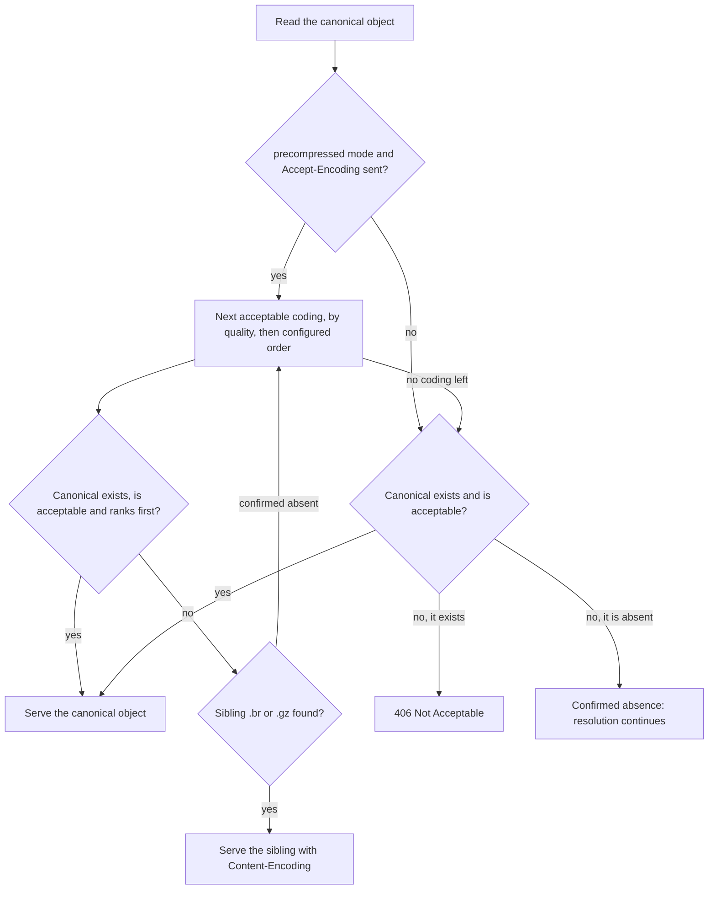

# Precompressed variants

Compression happens when you publish, not when **statica** serves: you publish compressed copies next to each object, such as a Brotli copy `app.js.br` and a gzip copy `app.js.gz` next to `app.js`, and statica serves them. With `compression.mode: precompressed`, statica chooses, for each request, the representation the client prefers among those that exist, and labels it with `Content-Encoding`. With `compression.mode: off`, it reads only the canonical object, the one the URL names, but it still respects that object's own declared encoding and the client's `Accept-Encoding`. [Serve precompressed files](../guide/precompressed-files.md) shows how to produce and upload the variants.

## Modes and configuration

| `compression.mode` | Behavior |
| --- | --- |
| `off` | No sibling lookups. The canonical object is served as stored, if the client accepts its encoding. |
| `precompressed` | statica also looks for sibling objects for the codings listed in `compression.encodings`. |

`compression.encodings` lists `br`, `gzip` or both, each at most once. Its order breaks ties between codings the client accepts with the same quality. It is only valid with `precompressed`.

```yaml [config.yaml]
compression:
  mode: precompressed
  encodings: [br, gzip]
```

## Sibling naming

A sibling's object key is the canonical key plus a fixed suffix: `.br` for Brotli and `.gz` for gzip. For the URL `/guide/` with the index object `index.html`, the candidates are `guide/index.html`, `guide/index.html.br` and `guide/index.html.gz` (under the publication prefix). Every object statica resolves is negotiated this way: ordinary objects, index objects, the SPA shell and the custom 404 page.

## Negotiation

Negotiation reads the canonical object first, then tries the siblings the client accepts. The diagram shows one logical object, for example the exact key of the URL.



Every response statica builds from this selection carries `Vary: Accept-Encoding`.

### Reading `Accept-Encoding`

- **Absent header.** Every coding is acceptable, and statica serves the canonical object as stored, without looking for siblings.
- **Empty header.** A header that is present with no value accepts `identity` (no encoding) only.
- **Members.** Each member is a coding name, compared without case, with an optional `;q=` quality. A valid quality is `0` or `1`, optionally followed by a point and up to three digits, and at most `1.000`. Any other quality, or a parameter other than a single `q`, makes the member a refusal (`q=0`).
- **Duplicates.** When a coding appears more than once, the lowest quality applies, so a later member cannot undo a refusal. Several `Accept-Encoding` field lines are combined into one list.
- **`identity`.** Acceptable unless it is listed with `q=0`, or `*;q=0` is present and `identity` is not listed.
- **`*`.** Gives its quality to `br` and `gzip` when they are not listed.
- **`q=0`.** Refuses the coding.

With `compression.encodings: [br, gzip]`, an identity `app.js` and both siblings published, statica selects:

| `Accept-Encoding` | Served |
| --- | --- |
| (absent) | `app.js` |
| (empty) | `app.js` |
| `gzip, br` | `app.js.br` (tie, configured order) |
| `gzip;q=1, br;q=0.5, identity;q=0` | `app.js.gz` |
| `br;q=0.5` | `app.js` (`identity` is not listed, so its quality is 1) |
| `*` | `app.js.br` |
| `*;q=0, identity;q=1` | `app.js` |
| `*;q=0` | 406 Not Acceptable |
| `br;q=0, br;q=1, gzip, identity;q=0` | `app.js.gz` (the refusal of `br` wins) |
| `br;q=1.001, gzip, identity;q=0` | `app.js.gz` (the malformed quality refuses `br`) |

### Order of the candidates

The configured codings are sorted by the client's quality, keeping the configured order among equal qualities, and refused codings are skipped. For each coding in turn, statica serves the canonical object if that object exists, is acceptable and ranks first; otherwise it reads the sibling for that coding.

Ranking compares client quality first. At equal quality, configured codings rank in configured order and `identity` ranks last. So, on a tie, a sibling wins over an unencoded canonical object, and a canonical object that is itself gzip-encoded wins over its `.gz` sibling, which statica then does not read.

A confirmed absence of a sibling moves on to the next coding. Any other origin result, such as a 403 Forbidden or a timeout, ends resolution with an error response: statica never falls back to another representation after an error.

### Why the canonical object comes first

The canonical object is read before any sibling because it supplies three facts:

- its actual encoding, since the canonical object may itself be encoded (see [An encoded canonical object](#an-encoded-canonical-object));
- its `Content-Type`, which the siblings inherit;
- whether the resource exists at all, which separates 404 from 406.

For a GET, statica requests the canonical object with an ordinary GET. When a sibling is then served, it closes the canonical response without reading its body. The exception is a canonical object that the memory cache can hold (for example, within `cache.max_object_bytes`) and does not hold yet: its shared fill downloads the whole object and stores it before the sibling is read, so the memory cache then holds both the canonical object and the sibling that is served.

## Sibling metadata

- **`Content-Encoding`.** A sibling without a declared `Content-Encoding` gets the coding of its suffix. A declared value must equal that coding (compared without case). Any other value, including `identity` or `gzip` on a `.br` object, is an invalid origin response: the request fails with 502 Bad Gateway and statica does not try another representation.
- **`Content-Type`.** The response uses the canonical object's `Content-Type` when the canonical object exists and declares a valid media type. Otherwise statica takes it from a [fixed table of file extensions](../reference/http-responses.md#content-type), applied to the canonical object's path (the sibling's path without the `.br` or `.gz` suffix), with `application/octet-stream` for unknown extensions. `app.js.br` is served as JavaScript, never as a Brotli or gzip file.
- **Everything else** comes from the sibling object itself: `ETag`, `Last-Modified`, `Content-Length`, `Cache-Control`, `Expires`, `Content-Disposition` and `Content-Language`.

::: tip Keep variant metadata in step
Publish every variant with the same `Cache-Control` (and the same `Content-Disposition` and `Content-Language`, if you use them). Each variant's own metadata applies, so a variant without `Cache-Control` gets a different browser caching policy from its canonical object.
:::

Rules match paths differently for the two cache layers. `cache_control` rules match the public request path, so they apply alike to every variant. Memory cache rules (`cache.rules`) match each variant's own object path, such as `/app.js.br`: an `exact` rule for `/app.js` does not cover its siblings, while a `prefix` rule covers all of them.

## 404 or 406

- **404 Not Found path.** When the canonical object is confirmed absent and no acceptable sibling exists, the URL has no object: resolution continues to the trailing-slash redirect, the SPA fallback or the 404 page, as for any missing object. Siblings the client does not accept play no part.
- **406 Not Acceptable.** When the canonical object exists but neither it nor any existing sibling is acceptable, statica answers 406 and resolution stops. The response has a short generated body, `Cache-Control: no-store` and `Vary: Accept-Encoding`. It is logged as an ordinary response (`outcome=success`), not as an origin failure ([statuses](../reference/http-responses.md#statuses-from-statica)).

::: warning A sibling without its canonical object
If `app.js.br` exists but `app.js` does not, clients that accept `br` receive the sibling, while clients that do not, including clients that send no `Accept-Encoding`, follow the 404 path. Always publish the canonical object.
:::

## `Vary: Accept-Encoding`

Every response built from resolution carries `Vary: Accept-Encoding`, in both modes: 200, 206, 304, 412 and 416 object responses, the 308 trailing-slash redirect, the SPA shell, custom and built-in 404 responses, and 406. `Accept-Encoding` can change the selection or turn it into a 406 even in `off` mode, so downstream caches must keep separate copies per value. The field is merged with any other `Vary` value, such as `Accept` on SPA routes (see [SPA fallback](./spa-fallback.md#the-response)). Configured redirects and other responses that never read the bucket do not carry it, nor do most responses to origin failures. The [`Vary` table](../reference/http-responses.md#vary) lists every member and the responses that carry it.

## Per-variant validators, ranges and cache entries

- **Validators.** `ETag` and `Last-Modified` belong to the variant that is served. Conditional requests compare against them: an `If-None-Match` that carries the ETag of `app.js` does not match `app.js.br`, so the client receives the Brotli body. ETags are never derived or rewritten.
- **Length.** `Content-Length` is the size of the encoded bytes.
- **Ranges.** A byte range applies to the encoded bytes of the selected variant, and `Content-Range` counts encoded bytes. When the range is read from the origin, statica checks that the variant's encoding did not change. See [Ranges and conditional requests](./ranges-and-conditionals.md).
- **Memory cache.** Each variant is a separate entry under its own key, with its own negative entry when it is missing. All variants count against the same byte and entry limits.
- **HEAD.** A HEAD request makes the same selection as a GET, using metadata reads of the canonical object and the siblings, and receives the same status and headers without a body.

## Cost in origin lookups

- Without sibling discovery (`off` mode, or a request without `Accept-Encoding`), each logical object costs one key.
- With discovery, each logical object costs the canonical key plus one key per acceptable configured coding, tried in order until one exists: at most three keys. A URL can involve up to four logical objects (exact key, index key, SPA shell, custom 404 page), so resolving a request reads at most twelve distinct keys, and never looks up the same key twice.
- Missing siblings become negative entries for `cache.negative_ttl`, like any missing object. Objects you do not publish variants for, such as images, still cost their sibling lookups again whenever those entries expire.
- S3 answers a HEAD for a missing key with a 404 that does not say why, so for a HEAD request statica confirms the absence with a GET. A missing key that is not in memory can then cost two origin operations.
- `statica_origin_operations_total` counts these lookups by operation, result (for example `not_found`) and purpose.

## An encoded canonical object

A canonical object whose metadata declares `Content-Encoding: gzip` or `Content-Encoding: br` is served with that header, in both modes, to clients that accept the coding or send no `Accept-Encoding` at all. It is never decompressed.

- In `precompressed` mode, an acceptable sibling that ranks higher wins, and a sibling with the same coding as the canonical object is not read.
- When neither the canonical object nor an existing sibling is acceptable, the answer is 406.
- A declared `Content-Encoding` of `identity` means no encoding: statica does not forward the header.
- Any other declared value, such as `deflate` or a list like `gzip, br`, is an invalid origin response: the request fails with 502 Bad Gateway, in both modes.

## Unsupported modes

`off` and `precompressed` are the only modes. Configuration validation, which runs before statica starts, rejects any other value of `compression.mode`, so a configuration that names a mode statica does not implement fails validation instead of being silently ignored.

## What statica does not do

- It does not compress responses or decompress stored objects.
- It does not serve codings other than `br` and `gzip`, such as `deflate` or `zstd`.
- It does not check that variants hold the same content as the canonical object: publish them together, for example under a release prefix.
- It does not look for siblings when the request has no `Accept-Encoding`.
- It does not choose a variant by size, and it does not derive ETags.

## Related pages

- [Request flow and URL mapping](./request-flow.md): the candidates each URL resolves through.
- [Memory cache](./memory-cache.md): entries, negative entries and limits.
- [Cache-Control and Age](./cache-control.md): how each variant's `Cache-Control` reaches the client.
- [SPA fallback](./spa-fallback.md): `Vary: Accept` on SPA routes.
- [Ranges and conditional requests](./ranges-and-conditionals.md).
- [Access denied](./access-denied.md): why a 403 on a sibling does not fall back to the canonical object.
- [Serve precompressed files](../guide/precompressed-files.md): producing, uploading and checking the variants.
- [HTTP responses reference](../reference/http-responses.md): the `Vary`, `Content-Encoding` and status of each response.
- [Configuration reference](../reference/configuration.md#compression): the `compression` keys.
