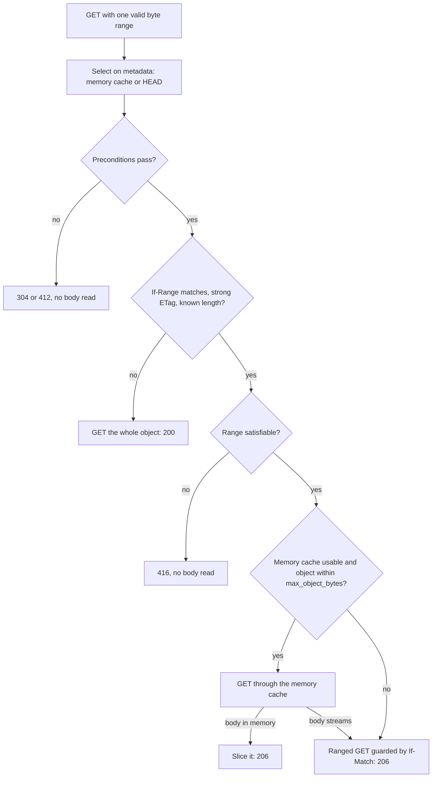

# Ranges and conditional requests

Conditional request headers and single byte ranges are evaluated by statica itself, against the representation it selected: the object, or the precompressed variant chosen for the request. It never forwards a client's conditional headers to the origin. A range comes either from a complete copy of the object in memory, called a memory snapshot on this page, or from the origin through a ranged read guarded by the object's ETag, so a response never combines the headers of one revision with the bytes of another.

## Order of evaluation

1. **Selection.** Resolution picks the object, including the index object, the SPA shell or a precompressed variant. For a GET with one valid byte range, it reads only metadata when the provider can serve ranges ([Selection on metadata](#selection-on-metadata)).
2. **Preconditions.** statica evaluates them only when the selection is a 200 OK object. A custom 404 page, a redirect or a generated response never becomes a 304 or a 412.
3. **Range.** statica considers `Range` only for a GET whose status is still 200 after the preconditions. A HEAD request ignores `Range` and receives the headers of the complete representation.

## Preconditions

The four conditional headers are checked in the order HTTP defines ([RFC 9110, section 13.2.2](https://www.rfc-editor.org/rfc/rfc9110.html#section-13.2.2)):

1. **`If-Match`.** When present and valid, the response is 412 Precondition Failed unless the value is `*` or one of the listed ETags matches the object's ETag by strong comparison.
2. **`If-Unmodified-Since`**, only when `If-Match` is absent. The response is 412 when the object's `Last-Modified` is later than the date.
3. **`If-None-Match`.** When present and valid, the response is 304 Not Modified if the value is `*` or one of the listed ETags matches by weak comparison.
4. **`If-Modified-Since`**, only when `If-None-Match` is absent. The response is 304 when the object's `Last-Modified` is not later than the date.

A 412 decision is final: statica does not go on to the 304 checks. Both GET and HEAD requests can receive 304.

- **Strong comparison** (`If-Match`): both ETags are strong and identical.
- **Weak comparison** (`If-None-Match`): the ETags are identical once a `W/` prefix is ignored.
- **Dates** are compared at one-second precision. A date condition applies only when the header appears exactly once, parses as an HTTP date, and the object has a `Last-Modified` time.
- **Malformed ETag lists** make statica ignore the header, but its presence still disables the date condition below it. A broken `If-None-Match` therefore never lets `If-Modified-Since` decide instead.
- **An object without a valid ETag** never matches a listed ETag: `If-Match` with a list fails with 412, and `If-None-Match` with a list never yields 304.

A 304 response has no body and drops `Content-Length`, `Content-Type` and `Content-Encoding`, keeping the validators, `Cache-Control` and `Vary` a 200 would carry. A 412 response has no body, `Content-Length: 0` and `Cache-Control: no-store` ([responses for an object](../reference/http-responses.md#generated-responses)).

Preconditions use the metadata of the selected representation, whatever `s3.features.conditional_reads` says: that setting only controls the conditional requests statica sends to the origin itself.

## Range requests

Each request can receive one byte range:

- The header must start with `bytes=` and hold one range: `first-last`, `first-` or `-suffix`, in decimal digits.
- The header is ignored, and the complete representation returned with 200 OK, for several ranges, whitespace inside the range, another unit, a malformed number, `last` lower than `first`, several `Range` fields, or an object whose length is unknown.
- A `last` beyond the end is cut to the last byte. A suffix longer than the object selects the whole object.
- A valid range that cannot be satisfied (`first` at or beyond the length, a zero suffix, or any range of an empty object) gets 416 Range Not Satisfiable with `Content-Range: bytes */<length>`, `Cache-Control: no-store` and a short generated body (`Requested Range Not Satisfiable`).
- A satisfied range gets 206 Partial Content with `Content-Range: bytes <first>-<last>/<length>` and the length of the range in `Content-Length`.

A 416 is possible only when statica would serve the range. When the range cannot be served at all (see below), the client receives the complete 200 instead.

### `If-Range`

`If-Range` lets a client ask for a range only if the object is still the revision it saw. The range is served only when the request carries one non-empty `If-Range` value that matches:

- **A strong ETag** must equal the object's ETag, which must be strong too.
- **An HTTP date** must equal the object's `Last-Modified` exactly, at one-second precision, and that `Last-Modified` must be at least 60 seconds earlier than the `Date` the origin sent with the object. A more recent modification time is not a strong enough validator, and a date never matches when the origin sent no valid `Date`.

A weak ETag, an unparseable value or several `If-Range` fields never match. When `If-Range` does not match, statica ignores `Range` and returns the complete representation with 200.

## Where a range comes from

The diagram shows what happens to a GET that carries one valid byte range when `s3.features.range_reads` and `s3.features.conditional_reads` are both enabled. With either one disabled, resolution reads the object as for any GET, and only a body held in memory answers the range ([Effect of `s3.features`](#effect-of-s3-features)).

### Selection on metadata

When `s3.features.range_reads` and `s3.features.conditional_reads` are both enabled, a GET whose `Range` header holds one range in the grammar above is resolved as a HEAD request is: statica reads the metadata of each candidate, from the memory cache or with a `HeadObject`, and no body. Then:

1. a failing precondition gets its 304 or 412, without a body read from the origin;
2. a range that does not apply (`If-Range` does not match, the ETag is weak or missing, or the length is unknown) gets the whole object with a GET and the complete 200, even when the range could not be satisfied;
3. an unsatisfiable range that applies gets its 416, without a body read from the origin;
4. a satisfiable range that applies comes from a complete memory snapshot or from the origin, as the next sections describe.

S3 answers a `HeadObject` for a missing key with a 404 that cannot confirm the absence, so each missing candidate (the exact key, the index key, a precompressed sibling or the SPA shell) costs a `HeadObject` and then a `GetObject` that confirms it, as for a HEAD request. With the memory cache, that confirmation stores a negative entry that later requests reuse ([negative entries](./memory-cache.md#negative-entries)). The custom 404 page never answers a range, so statica reads it with a GET directly.

### From a complete memory snapshot

When the body is a complete copy in memory, statica slices it. That is the case for a fresh entry, an entry the origin has confirmed on revalidation or that is served stale, and an object that this request itself read into memory because it is eligible for the memory cache (for example, within `cache.max_object_bytes`). The snapshot holds one revision's metadata and bytes together, and stays in place while the response uses it, so no guard is needed, and this works whatever the `s3.features.range_reads` and `s3.features.conditional_reads` settings are. The object still needs a strong ETag, as for ranges from the origin.

With both settings enabled, statica reads the body through the memory cache only for an object within `cache.max_object_bytes` whose metadata lookup did not bypass the cache. A cold range request for such an object reads its metadata, then the whole object through a shared fill, then slices it. If the fill cannot hold the body, because a fill limit or the fill budget is reached, statica closes that body unread and reads the range from the origin instead.

### From the origin

When the body cannot come from memory (the object exceeds `cache.max_object_bytes`, has no known length, may not be stored, finds the fill limits reached, or the memory cache is disabled or bypassed for the request), statica serves the range from the origin only if:

- `s3.features.range_reads` and `s3.features.conditional_reads` are both enabled;
- the object's length is known;
- its ETag is strong.

Then statica:

1. sends a GET with the range and `If-Match: <selected ETag>`;
2. checks that the answer covers exactly the requested bytes with the same ETag, and fails with 502 Bad Gateway if it does not;
3. checks that the encoding is unchanged and that `If-Range`, if present, still matches;
4. answers 206 with the metadata of the ranged response, which can carry metadata changes that did not alter the ETag, after evaluating the preconditions again against it.

If the object changed after its selection (the origin rejects `If-Match`, the encoding differs, `If-Range` no longer matches, or the whole object read for a 200 or a slice has another ETag or encoding than the selected metadata), statica restarts the whole resolution once. That second resolution revalidates every memory cache lookup with the origin, as a request with `Cache-Control: no-cache` would, so metadata held in memory cannot select the replaced revision again. If the object changes again, the answer is 503 Service Unavailable, logged with `error_class=origin_inconsistent`.

When any condition is missing, statica ignores `Range` and streams the complete object with 200. It never reads a large object into memory to make a range possible.

A range from the origin costs a `HeadObject` and the guarded ranged `GetObject`. While the memory cache holds the object's metadata, it costs the ranged `GetObject` alone, and the access log records `cache=metadata_hit`.

### Effect of `s3.features`

| `range_reads` and `conditional_reads` | Selection | Body in memory | Body that streams | `Accept-Ranges: bytes` |
| --- | --- | --- | --- | --- |
| both `true` | on metadata | 206 from the snapshot | 206 through a guarded ranged GET | sent, for objects with a known length and a strong ETag |
| either `false` | with a GET, as without `Range` | 206 from the snapshot | complete 200 | never sent |

With `s3.features.conditional_reads: false`, the memory cache also revalidates expired entries by reading the whole object again instead of sending a conditional request.

::: warning The same URL can answer 206 or 200
With either feature disabled, a range request returns 206 when the object is in memory and 200 with the complete body when it is not. This is deliberate: a memory copy is self-consistent, and statica does not buffer large objects to manufacture range support. HTTP allows a server to ignore `Range`, and clients must handle both answers.
:::

### `Accept-Ranges`

`Accept-Ranges: bytes` is sent on 200 and 206 responses for an object when `s3.features.range_reads` and `s3.features.conditional_reads` are both enabled and the object has a known length and a strong ETag. It is never sent on a 304, a 412 or the `not_found` object's 404, where ranges do not apply. The decision depends only on the configuration and the object's metadata, never on whether the object is in memory, so GET and HEAD, cached and uncached responses agree. A 206 sliced from memory can therefore arrive without `Accept-Ranges`. `Accept-Ranges: none` is never sent.

## Never mixing revisions

- A memory snapshot serves metadata and bytes of one revision.
- A range from the origin is guarded by `If-Match` on the selected ETag, and its response metadata comes from the ranged response itself.
- A change between selection and ranged read restarts resolution once, then fails with 503. A response that started with one revision never continues with bytes of another.

## Edge cases

- **Weak or missing ETags.** If the origin's ETag for an object is weak or missing, statica serves no range for it, from memory or from the origin, and `If-Match` with an ETag list always fails.
- **Precompressed variants.** Ranges and `Content-Range` count the encoded bytes of the selected variant. See [Precompressed variants](./precompressed-variants.md).
- **SPA shell and index objects.** They are 200 responses, so preconditions and ranges apply to them. See [SPA fallback](./spa-fallback.md).
- **A request with `Cache-Control: no-store`** bypasses the memory cache, so its range can only come from the origin.

## What statica does not do

- It does not serve several ranges in one response (`multipart/byteranges`).
- It does not apply `Range` to HEAD requests.
- It does not forward a client's conditional headers to the origin.
- It does not buffer a large object to serve a range from it.
- It does not resume or retry an interrupted download: resuming with `Range` and `If-Range` is a client capability. See [Timeouts and long downloads](./timeouts.md#long-downloads-and-resumption).
- It does not generate ETags.

## Related pages

- [Memory cache](./memory-cache.md): when a body is held in memory, and how entries are revalidated.
- [Precompressed variants](./precompressed-variants.md)
- [Timeouts and long downloads](./timeouts.md)
- [SPA fallback](./spa-fallback.md)
- [HTTP responses reference](../reference/http-responses.md): the statuses and headers of 206, 304, 412 and 416 responses, and `Accept-Ranges`.
- [Configuration reference](../reference/configuration.md#s3-features): the `s3.features` keys.
