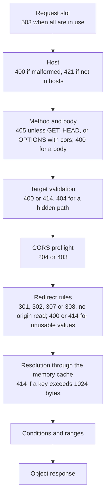
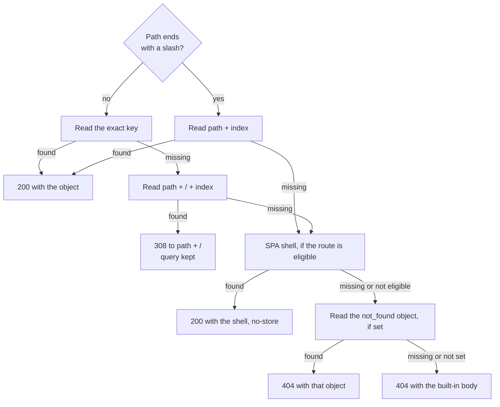

# Request flow and URL mapping

This page follows a request from the public listener to its response: the checks that can reject it, the redirect rules, and the order in which statica maps its path to object keys and falls back when an object is missing. Every step before resolution is local: a request that is rejected or redirected there never reaches the memory cache or the origin. The [HTTP responses reference](../reference/http-responses.md) lists every status and header that results.

## The request pipeline

Each request passes these steps in order. A step that rejects the request answers it with a generated response: a short plain-text body with `Cache-Control: no-store`.

Before these steps, the client IP and the request ID of every request are determined, rejected requests included.

### Request capacity

The first step takes one of [`server.max_concurrent_requests`](../reference/configuration.md#server-max-concurrent-requests) request slots, before any other check. When every slot is in use, the request gets 503 Service Unavailable at once: there is no queue of waiting requests. A request holds its slot until its response ends, streaming included. Open connections are bounded separately by [`server.max_connections`](../reference/configuration.md#server-max-connections).

### Host admission

The `Host` must be an ASCII hostname, an IPv4 address or a bracketed IPv6 address, with an optional valid port. The port is removed, hostnames are lowercased and one trailing dot is removed. A malformed `Host` gets 400 Bad Request.

When [`hosts`](../reference/configuration.md#hosts) is set, the normalized hostname must be one of its entries, or the request gets 421 Misdirected Request. Entries in `hosts` may be internationalized names: statica converts them to their ASCII form at startup, but it never converts a visitor's `Host`, so a client must send the ASCII form, as browsers do. Without `hosts`, every valid hostname is accepted.

In an absolute-form request target such as `https://www.example.com/guide/`, the target's authority is the host that statica checks: a conflicting `Host` header cannot override it. The hostname never selects the bucket, the prefix or the endpoint.

### Methods and CORS preflight

The methods served are `GET` and `HEAD`. `OPTIONS` is accepted only when [`cors`](../reference/configuration.md#cors) is configured, as a CORS preflight. Any other method gets 405 Method Not Allowed with `Allow: GET, HEAD`, or `Allow: GET, HEAD, OPTIONS` when `cors` is configured. A `GET` or `HEAD` that carries a request body gets 400 Bad Request, and statica does not read the body.

A preflight is answered after target validation and never reaches the redirect rules or the origin. It gets 204 No Content with `Access-Control-Allow-Origin` and `Access-Control-Allow-Methods: GET, HEAD` when all of these hold:

- its single `Origin` is listed in [`cors.allowed_origins`](../reference/configuration.md#cors-allowed-origins);
- `Access-Control-Request-Method` is `GET` or `HEAD`;
- every header in `Access-Control-Request-Headers` is one of `Range`, `If-Match`, `If-None-Match`, `If-Modified-Since`, `If-Unmodified-Since` and `If-Range`.

Otherwise it gets 403 Forbidden. For `GET` and `HEAD`, CORS only adds `Vary: Origin` and, for an allowed origin, `Access-Control-Allow-Origin`; a request from another origin is still served, without a grant ([Allow cross-origin reads](../guide/headers-and-cors.md#allow-cross-origin-reads)).

### Target validation

Percent-escapes in the path are decoded exactly once, segment by segment, with URL path rules: `%20` becomes a space and `+` stays a literal plus. It does not normalize Unicode, resolve `.` and `..`, or merge slashes. It rejects such paths instead of cleaning them.

These targets get 400 Bad Request:

- a malformed percent-escape, invalid UTF-8 or a control character, in the path or in the query;
- an encoded slash (`%2F`), an encoded backslash (`%5C`) or a literal backslash;
- a `.` or `..` segment, encoded or not;
- an empty segment, as in `//`: only a final trailing slash is allowed;
- a `%HH` sequence left after decoding, such as `%252e`, which decodes to `%2e`;
- a fragment (`#`), user information, or an absolute-form target whose scheme is not `http` or `https`.

A request target longer than 8 KiB (8192 bytes), query included, gets 414 URI Too Long. Request headers larger than [`server.max_header_bytes`](../reference/configuration.md#server-max-header-bytes) are refused earlier, by the HTTP server itself, with 431 Request Header Fields Too Large.

**Hidden segments.** A decoded path segment that starts with a dot is hidden, and the request gets 404 Not Found from statica without any origin read. The only exception is a first segment that is exactly `.well-known`: `/.well-known/security.txt` is served, while `/.well-known/.secret` and `/docs/.well-known/` are hidden. Decoding comes first, so `/%2Egit/config` is hidden too. This 404 always has the built-in body: the `not_found` object is not used ([Keep hidden files out of reach](../guide/publishing.md#keep-hidden-files-out-of-reach)).

**Mapping to an object key.** The object key is the publication prefix followed by the decoded path without its leading slash. A path that ends with a slash gets the [`index`](../reference/configuration.md#index) filename appended. With [`s3.prefix`](../reference/configuration.md#s3-prefix) set to `docs`:

| Request path | Object key or response |
| --- | --- |
| `/` | `docs/index.html` |
| `/guide/` | `docs/guide/index.html` |
| `/logo.svg` | `docs/logo.svg` |
| `/a%20b.txt` | `docs/a b.txt` |
| `/a+b.txt` | `docs/a+b.txt` |
| `/caf%C3%A9.html` | `docs/café.html` |
| `/../secret`, `/%2e%2e/secret`, `/%252e%252e/secret` | 400, no origin read |
| `/a%2Fb`, `/a%5Cb`, `//example.com/file` | 400, no origin read |
| `/.git/config`, `/%2Egit/config` | 404, no origin read |

An object key, publication prefix included, is at most 1024 bytes. A request whose key would be longer gets 414 URI Too Long, unless a redirect rule answered it first: this check runs after the redirect rules.

### Redirect rules

The [`redirects`](../reference/configuration.md#redirects) rules are evaluated in order against the validated path and query, and the first rule that matches answers the request with its status (301 Moved Permanently, 302 Found, 307 Temporary Redirect or 308 Permanent Redirect) and a `Location` header, with `Cache-Control: no-store`. A redirect reads nothing from the memory cache or the origin. When a request's values cannot be placed safely in a rule's destination, the request gets 400 Bad Request, or 414 URI Too Long when the result would be too long. [Configure redirects](../guide/redirects.md) shows how to write the rules.

Target validation runs first, so a hidden or invalid path gets its 404 or 400 even when a redirect rule would match it.

### After resolution

Once resolution has selected an object, the conditional request headers and a `Range` header are evaluated against it, then the object response is written: 200 OK, 206 Partial Content, 304 Not Modified, 412 Precondition Failed or 416 Range Not Satisfiable. A `HEAD` request follows the same resolution and gets the headers a `GET` would get, without a body; `Range` is ignored on `HEAD`. [Ranges and conditional requests](./ranges-and-conditionals.md) describes these rules.

## From path to object

Resolution tries a fixed sequence of candidates. Each candidate is read through the memory cache, and only a confirmed absence lets resolution move to the next one.

### Candidates

1. **A path that ends with a slash** reads `<path><index>` directly, for example `docs/guide/index.html` for `/guide/`. No prefix is ever listed to find out whether it exists. The exact key without the slash is not tried.
2. **Any other path** reads its exact key. When that key is confirmed missing, resolution reads `<path>/<index>`. If that object exists, the response is 308 Permanent Redirect to the same path with a trailing slash, with the query kept exactly as sent: `/guide?lang=en` gets `Location: /guide/?lang=en`. The `Location` is a relative reference (path and query), and the index object's body is not sent.
3. **The single-page-app shell.** When [`spa`](../reference/configuration.md#spa) is configured and the route is eligible, a request that accepts `text/html` gets the shell object with 200 and `Cache-Control: no-store`. [SPA fallback](./spa-fallback.md) describes the eligibility rules.
4. **The custom 404 page.** When [`not_found`](../reference/configuration.md#not-found) is set, that object is read once. If it exists, the response is 404 Not Found with its body and `Content-Type`, `Cache-Control: no-store`, and no `ETag` or `Last-Modified`. Conditional and range headers do not apply to it.
5. **The built-in 404.** Otherwise the response is 404 Not Found with a plain-text body and `Cache-Control: no-store`.

The access log records which candidate answered in its [`resolution`](../reference/logs.md#resolution) field: `ordinary` for the exact key, `index` for an index object or the 308, `spa` for the shell, and `not_found` for both 404 responses.

The `index`, `not_found` and `spa.fallback` settings name objects relative to the publication prefix. They are object keys, not request paths, so the hidden-segment rule does not apply to them. [Publish a site to S3](../guide/publishing.md) shows how to lay out the bucket for this order.

### Only a confirmed absence continues

A candidate read has three possible results: the object exists, the object is confirmed missing, or something else happened. Only an S3 404 with the error code `NoSuchKey`, or a negative entry in the memory cache that recorded one, confirms an absence. Any other result stops resolution at once and becomes the response:

| Origin result | Response |
| --- | --- |
| 403 Forbidden | 404 Not Found with the built-in body, or 502 Bad Gateway, as [`errors.access_denied`](../reference/configuration.md#errors-access-denied) selects |
| Timeout | 504 Gateway Timeout |
| Throttling that persists after the configured attempts | 503 Service Unavailable |
| Any other failure: a 5xx, a network error, a bucket or endpoint error such as `NoSuchBucket`, a 404 without `NoSuchKey`, an invalid response | 502 Bad Gateway |

Every 403 answer counts as a denial, whatever its error code: credential errors that the provider answers with 403, such as `InvalidAccessKeyId`, `SignatureDoesNotMatch` or `AccessDenied`, follow the first row. A credential error answered with another status falls in the last row.

Error responses are generated responses with `Cache-Control: no-store`. An object that exists, but in no content coding that the request accepts, also stops resolution, with 406 Not Acceptable (see [Precompressed variants](./precompressed-variants.md)). [Access denied](./access-denied.md) describes the handling of 403 answers, and [Timeouts and long downloads](./timeouts.md) the deadlines behind 504.

A fallback after a failure would hide the failure: a denied or unreachable object would turn into a single-page-app shell with 200, or into a custom 404 page, and nothing in the response would show that the origin had failed. For the same reason, a failure while reading a fallback object, such as the `not_found` object, is an error response and not a missing page. When [`cache.stale_if_error`](../reference/configuration.md#cache-stale-if-error) allows it, the memory cache can answer a failed read with an expired copy; the read then counts as found. [Memory cache](./memory-cache.md#stale-if-error) describes when.

S3 answers a missing object to a `HeadObject` with a 404 that carries no error code, so a `HEAD` request cannot confirm an absence by itself. The same key is then read with `GetObject`, through the memory cache, before the object counts as missing: a `HEAD` answered that way reads the key twice. [Memory cache](./memory-cache.md#head-requests) describes what that `GetObject` stores.

::: warning
Every candidate key must fit in 1024 bytes when it is built. When the exact key is confirmed missing but `<path>/<index>` would be longer than 1024 bytes, the request gets 414 URI Too Long instead of 404 Not Found. With [`compression.mode`](../reference/configuration.md#compression-mode) set to `precompressed`, a variant key longer than 1024 bytes has the same effect.
:::

### Bounds on candidates and reads

A request reads at most four candidates: the exact key, the index object, the single-page-app shell and the `not_found` object. With `compression.mode: precompressed`, each candidate can add its `.br` and `.gz` variants, for at most 12 distinct object keys per request. Each key is read at most once per request: a key already confirmed missing, or a candidate that repeats an earlier one, such as `not_found: index.html` for a request to `/`, counts as missing without another read. Each of these reads can make up to [`s3.max_attempts`](../reference/configuration.md#s3-max-attempts) attempts at the origin.

### The query never selects an object

The query string is validated, matched and expanded by redirect rules, and kept on the 308 to the trailing-slash path. It is never part of an object key or of a memory cache entry, and it is never sent to S3, so parameters such as `versionId` or `response-content-type` have no effect. No visitor header reaches S3 either: a request to the origin names the bucket and the object key, plus a condition or a byte range that statica computes itself.

## What statica does not do

- It does not list the bucket: a directory path is served only through its index object.
- It does not clean or normalize paths: it rejects `..`, `//` and encoded separators instead.
- It does not select a site, a bucket or a prefix by hostname.
- It does not let the query select an object, an object version or response headers.
- It does not apply S3 static website hosting features such as routing rules or per-object website redirects.

## Related pages

- [Architecture overview](./index.md)
- [Memory cache](./memory-cache.md)
- [Cache-Control and Age](./cache-control.md)
- [Publish a site to S3](../guide/publishing.md), [Configure redirects](../guide/redirects.md) and [Response headers and CORS](../guide/headers-and-cors.md): the settings behind each step.
- [Connect to S3 and S3-compatible providers](../guide/s3-providers.md#common-failures) and [Troubleshooting](../guide/troubleshooting.md): what origin failures look like, and how to find their cause.
- [HTTP responses reference](../reference/http-responses.md): every status and header.
- [Log reference](../reference/logs.md#resolution): the `resolution` field.
- [Configuration reference](../reference/configuration.md)
