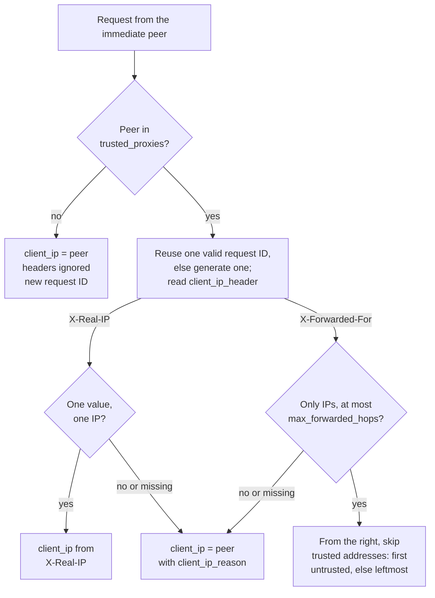

# Security model

**statica** serves one publication prefix of one bucket as a public website. Visitors are untrusted: they control URLs, headers and how their connections behave. Operators are trusted: they control the configuration, the credentials, the network and the admin listener. Publishers are trusted too: whatever they put under the publication prefix is served as the site. This page describes how each boundary is enforced, what statica logs and exposes, and what stays your responsibility.

## Trust boundaries

| Party | Controls | Trusted |
| --- | --- | --- |
| Visitors | Request targets, headers, connection timing | No |
| Operators | Configuration, credentials, network placement, the admin listener | Yes |
| Publishers | Every object under the publication prefix and its metadata | Yes, as content |

::: danger A private bucket becomes a public site
The process reads the bucket with its own credentials and serves every object under the publication prefix to anyone who can reach the public listener. A bucket that is private in S3 does not keep its published objects private. Put only public content under the prefix.
:::

::: danger Publisher content is trusted
Objects are served as they are stored: statica does not inspect or sanitize HTML, scripts or SVG, so anything placed under the prefix runs with your site's origin in visitors' browsers. Do not let untrusted users write under the publication prefix.
:::

## Requests cannot leave the publication prefix

Every request target is validated before it is turned into an object key, and the key is built by concatenation, never by cleaning a path:

- The request target (path and query together) is limited to 8 KiB; a longer one gets 414 URI Too Long. A target with a fragment or user information gets 400 Bad Request, and an absolute-form target must use `http` or `https` and name the same authority as `Host`.
- The path is decoded exactly once, one segment at a time. A decoded segment is rejected with 400 when it is `.` or `..`, contains `/` or `\` (so `%2F` cannot create a new segment), contains a control character or invalid UTF-8, or still contains a percent-encoded sequence (a double encoding such as `%252e`). Empty segments, as in `//`, are rejected too, except for a trailing slash.
- A path with a segment that starts with a dot gets 404 Not Found without any origin request, except a first segment `.well-known`.
- The query never takes part in choosing the object.
- The object key is the publication prefix followed by the decoded path without its leading slash; a trailing slash appends the `index` file name. A key longer than 1024 bytes gets 414.

The origin client checks every key again before sending a request: it must start with the publication prefix, fit in 1024 bytes and contain no empty, `.` or `..` segment, backslash or control character. Configured keys (`index`, `not_found`, `spa.fallback`, `admin.origin_health.key`) are validated as safe relative keys when the configuration loads, and `s3.prefix` is normalized and validated the same way.

## Host never selects the origin

The bucket, the endpoint and the publication prefix are fixed when the process starts. The `Host` header of a request is validated, normalized and used for admission, logs and metrics, but it never selects a bucket, a prefix or an object, and it is not part of the memory cache's identity: the cache identifies entries by object key alone, so every host name shares the same entries. Forwarded host headers such as `X-Forwarded-Host` are never read; if a proxy sits in front of statica, configure it to pass the original `Host` through. Redirect rules cannot be steered either: a destination's origin is written literally in the rule, and captured request values only fill its path and query.

The authority is parsed as ASCII only. It is lowercased and loses its port and any trailing dot. A malformed authority that reaches statica gets 400 Bad Request (`malformed_host`), with or without a host allowlist. Some malformed requests never reach it: see [Responses statica does not produce](#responses-statica-does-not-produce).

### Host allowlist

The optional `hosts` list admits only the listed names: exact DNS names or IP literals, without ports or wildcards. Internationalized names are converted to their ASCII form when the configuration loads. A request for any other host gets 421 Misdirected Request (`unknown_host`) before redirects, the memory cache or the origin are consulted.

```yaml [config.yaml]
hosts: [example.com, www.example.com]
```

Rejected requests are counted in `statica_http_rejected_requests_total` by their fixed `reason` only, without a host label, so names chosen by a client never reach the metrics through a rejection. Admitted requests carry their normalized host as the `host` label of the request metrics, and those series are never removed.

::: warning Host labels without an allowlist
Without `hosts`, every syntactically valid host name is admitted and becomes a `host` label value. A client that sends many different names makes the number of series, and the memory they use, grow without limit. Configure `hosts` whenever clients can reach the public listener directly.
:::

## TLS on the public listener

With `server.tls`, the public listener serves HTTPS only:

- `server.tls.min_version` is `"1.2"` or `"1.3"`; the cipher suites are Go's defaults.
- HTTP/2 is negotiated through ALPN alongside HTTP/1.1. Without TLS, the listener serves cleartext HTTP/1.1 only.
- The certificate and key are checked by `statica config validate` and before `serve` starts: a missing file or a key that does not match the certificate exits with status 2. They are read only at startup.
- One certificate chain serves every name; the TLS server name does not select a different certificate or site.

```yaml [config.yaml]
server:
  listen: ":8443"
  tls:
    cert_file: /etc/statica/tls/cert.pem
    key_file: /etc/statica/tls/key.pem
headers:
  set:
    Strict-Transport-Security: max-age=31536000
```

Only `server.listen` is bound: statica never adds a cleartext listener or an HTTP to HTTPS redirect. It sends `Strict-Transport-Security` only when you set it in `headers.set`, as above, and never infers HTTPS from forwarded headers such as `X-Forwarded-Proto`, which it does not read. [Serve HTTPS directly](../guide/tls.md) walks through the setup, including [`Strict-Transport-Security`](../guide/tls.md#send-strict-transport-security).

## Trusted proxies and client IP attribution

The client IP of a request is the address of the immediate peer, the other end of the TCP connection, unless that peer is a proxy you trust. Only then does statica read the forwarded header named by `server.client_ip_header`:



The rules:

- `server.trusted_proxies` is a list of CIDR ranges. A range that trusts every address, such as `0.0.0.0/0` or `::/0`, is rejected, and IPv4 ranges must be written in native IPv4 form, not as IPv4-mapped IPv6. An IPv4-mapped peer address is compared as plain IPv4.
- `server.client_ip_header` is `X-Forwarded-For` or `X-Real-IP`; statica reads only that header. The RFC 7239 `Forwarded` header is not supported.
- `X-Forwarded-For` values are read across all header lines, split on commas and parsed as bare IP addresses: an entry with a port, an empty entry or any other text invalidates the whole chain. The chain may hold at most `server.max_forwarded_hops` entries and at most 64 bytes per allowed hop in total.
- Walking from the right, statica skips the addresses of trusted proxies and takes the first untrusted one. If every entry is trusted, it takes the leftmost.
- `X-Real-IP` must appear once and hold one IP address.
- When attribution falls back to the peer, the access event says why in `client_ip_reason`.

```yaml [config.yaml]
server:
  trusted_proxies: [10.0.12.0/24]
  client_ip_header: X-Forwarded-For
  max_forwarded_hops: 4
```

::: warning Trust only your proxies
Any client whose address is inside `server.trusted_proxies` can choose the client IP that statica logs and the request ID that it reuses. List your proxies' own addresses, or the narrowest ranges that contain them, rather than a whole private network shared with other workloads. Configure each proxy to append the address it sees to `X-Forwarded-For`, and to overwrite `X-Real-IP` and the request ID header instead of passing a client's values through.
:::

| `client_ip_source` | Client IP taken from |
| --- | --- |
| `peer` | The immediate peer's address |
| `x_forwarded_for` | The `X-Forwarded-For` chain |
| `x_real_ip` | The `X-Real-IP` header |

| `client_ip_reason` | Why the peer address was used |
| --- | --- |
| `missing_client_ip_header` | The peer is trusted but sent no client IP header |
| `invalid_forwarded_chain` | An `X-Forwarded-For` entry is not a bare IP address |
| `forwarded_chain_too_long` | The chain exceeds `max_forwarded_hops` entries or its byte bound |
| `invalid_real_ip` | `X-Real-IP` is repeated or is not one IP address |
| `invalid_peer` | The connection's peer address could not be parsed |

The client IP is attribution, not authorization: statica makes no access decision from it, and it never becomes a metric label. The access log records the client IP and the peer address while `observability.log_client_ip` is `true`, which is the default; set it to `false` to keep IP addresses out of the logs. [Run behind a reverse proxy, CDN or ingress](../guide/behind-a-proxy.md#trust-only-your-proxies) shows how to configure the trusted ranges and the header.

## Request IDs

Every response that statica produces on the public listener carries a request ID in `X-Request-ID`, and the `http_request` event logs it as `request_id`, with `request_id_source` set to `proxy` or `generated`.

- The ID from the header named by `server.request_id_header` is reused only when the immediate peer is inside `server.trusted_proxies`, the header appears exactly once, and its value has 1 to 128 characters among letters, digits, `.`, `_`, `:` and `-`.
- Otherwise statica generates one: 32 hexadecimal characters from 16 random bytes. For a trusted peer, `request_id_reason` says why its ID was not used: `missing_request_id` or `invalid_request_id`. For an untrusted peer the header is ignored silently.
- `server.request_id_header` cannot name a header with another role: hop-by-hop headers, `Host`, `Authorization`, `WWW-Authenticate`, `Cookie`, `Set-Cookie`, `Content-Length`, `X-Forwarded-For`, `X-Real-IP` or `Forwarded`. The response header is always `X-Request-ID`, whatever the request header is called.

A request ID never becomes a metric label. [Pass request IDs](../guide/behind-a-proxy.md#pass-request-ids) shows how to reuse a proxy's IDs.

## Origin credentials

Credentials come from the standard AWS SDK credential chain, for example environment variables, shared configuration and credential files, or a role attached to the workload, and the SDK refreshes temporary credentials. The configuration file has no credential fields, and unknown keys are rejected, so credentials cannot be written into it. Values substituted from environment variables with `${VAR}` are shown as `[REDACTED]` by `statica config print`.

Origin access is read-only: statica issues `GetObject` and `HeadObject` requests for keys under the publication prefix, and never lists, writes or deletes, even when the credentials allow it. Read access to the objects under the prefix is all it needs, but on AWS S3 that choice has a cost. Without the `s3:ListBucket` permission, AWS S3 answers 403 Forbidden for a key that does not exist. For such a denial, statica responds with 404 Not Found by default (`errors.access_denied: not_found`) or with 502 Bad Gateway (`bad_gateway`), never caches it, logs it as an origin error and runs no fallback: no trailing-slash redirect, no SPA fallback and no custom 404 page. [AWS without `s3:ListBucket`](./access-denied.md#aws-without-s3-listbucket) describes the trade-off.

Credentials never appear in logs or command output. Origin errors are reduced to a fixed classification before they reach the logs, the metrics or standard error, so provider error messages, signed URLs and endpoint addresses are never copied. [Provide credentials](../guide/s3-providers.md#provide-credentials) shows a read-only policy and the credential sources.

## Origin connections

- **Verified HTTPS by default.** Connections to the origin use TLS 1.2 or later and verify the certificate and host name.
- **`s3.insecure_skip_verify: true`** keeps encryption but skips certificate and host name verification for origin requests, health checks included. Requests to credential providers always keep full verification. The `startup` event reports `s3_insecure_skip_verify=true` and is followed by the `origin_tls_verification_disabled` warning, and `statica config check-origin` prints a warning too. The setting is rejected with an `http://` endpoint.
- **`s3.allow_http: true`** is required for an `http://` `s3.endpoint`. Requests, their signatures and object data then cross the network unencrypted.
- **Fixed destination.** Only `s3.endpoint` selects a custom endpoint; endpoint overrides from the AWS environment or shared configuration are ignored. Redirects from the origin are never followed.
- **Proxies.** Origin and credential requests honor the standard `HTTP_PROXY`, `HTTPS_PROXY` and `NO_PROXY` environment variables.

::: danger Unverified origin TLS
With `s3.insecure_skip_verify: true`, anyone who can intercept the connection to the origin can read and alter the site's content. Use it only to reach a test endpoint with a certificate you cannot otherwise trust.
:::

[Keep origin TLS verified](../guide/s3-providers.md#keep-origin-tls-verified) shows how to trust a private certificate authority instead.

## Response safety

Only an allowlist of origin metadata reaches visitors:

- `Content-Type` when the origin's value is a valid media type, otherwise a type chosen from a fixed table by file extension, otherwise `application/octet-stream`;
- `Content-Length`, `ETag` and `Last-Modified`;
- `Content-Encoding` only when it is `gzip` or `br`;
- `Content-Disposition` and `Content-Language` when they are well formed;
- `Cache-Control`, `Expires`, `Date` and `Age`, with malformed cache metadata replaced by `Cache-Control: no-store`.

User-defined object metadata and any other origin header are never forwarded. A CR, LF or NUL in any metadata value that statica reads makes the whole origin response invalid.

Every response that statica produces on the public listener also carries `X-Content-Type-Options: nosniff` and `X-Request-ID`. Responses that statica generates itself, such as errors and redirects, have a short plain-text body naming the status, carry `Cache-Control: no-store` and never include origin error details.

Static headers from `headers.set`, such as a `Content-Security-Policy` or a `Referrer-Policy`, are added to every response that statica produces on the public listener. Names that statica controls are reserved and rejected when the configuration loads: hop-by-hop headers, every `Access-Control-*` header, `Host`, `Location`, `Set-Cookie`, `Cookie`, `Authorization`, `WWW-Authenticate`, `X-Request-ID`, `X-Content-Type-Options`, `Content-Type`, `Content-Length`, `Content-Encoding`, `Content-Range`, `Content-Disposition`, `Content-Language`, `ETag`, `Last-Modified`, `Accept-Ranges`, `Cache-Control`, `Expires`, `Age`, `Date` and `Vary`. Values cannot contain CR, LF, DEL or any other ASCII control character except tab.

CORS is off unless you set `cors.allowed_origins`, and its grants are narrow:

- only exact HTTP(S) origins match, with no wildcard; an allowed request's `Origin` is echoed in `Access-Control-Allow-Origin`, and responses vary on `Origin`;
- credentials are never allowed, and only `GET` and `HEAD` are granted;
- a preflight may only ask for `Range`, `If-Match`, `If-None-Match`, `If-Modified-Since`, `If-Unmodified-Since` and `If-Range`; any other preflight gets 403 Forbidden (`cors_preflight_denied`) without an origin request.

CORS controls what browsers let other sites read; it is not access control. A request from an origin that is not allowed is still served, without a grant. [Response headers and CORS](../guide/headers-and-cors.md) shows how to set both, and the [HTTP responses reference](../reference/http-responses.md#response-headers) lists every header statica sends.

### Responses statica does not produce

Go's HTTP server rejects a few malformed requests before statica sees them: for example an HTTP/1.1 request without `Host`, a `Host` header with bytes outside the allowed ASCII set, or request headers larger than `server.max_header_bytes`, which get 431 Request Header Fields Too Large. Those responses carry no `X-Request-ID`, no `nosniff` and none of the `headers.set` headers, and they are neither logged nor counted in the metrics.

## Safe logging

Logs are logfmt events, one per line, on standard output:

- **Escaping.** Values are escaped by the logfmt encoder, so a hostile value cannot start a new line or forge an event. C1 control characters, Unicode line and paragraph separators and invalid UTF-8 become U+FFFD.
- **Bounds.** Each value is cut to 16 KiB at a character boundary. The logged `path` is cut to 8 KiB, with `path_truncated=true`, the raw authority of a request that did not pass host admission to 256 bytes, and the method to 32 bytes.
- **Query redaction.** The `path` field keeps the query, but the values of the parameters listed in `observability.redact_query_params` become `[REDACTED]`. Names are compared without ASCII case after one decoding, and only `&` separates parameters. A query that cannot be decoded is left out, with `query_redaction_failed=true`.
- **Never logged.** Other request headers (cookies, `Authorization`, `Referer`, `User-Agent` and the rest), redirect destinations, provider error messages and credentials. The Go HTTP server's own error messages, such as TLS handshake errors that carry client addresses, are discarded; only a handler panic becomes a fixed event, `http_server_error` or `admin_http_error` with `error_class=handler_panic`.
- **Logged on purpose.** The normalized `host`, or as `authority` the raw authority of a request that did not pass host admission; the request ID, including one reused from a trusted proxy; `origin_key`, the object key with its publication prefix, for responses backed by an object; and, while `observability.log_client_ip` is `true` (the default), `client_ip`, `peer_ip`, `client_ip_source` and `client_ip_reason`, including a client IP taken from a forwarded header.
- **Bounded output.** Events go through a bounded queue. When standard output stalls, new events are dropped and counted in `statica_log_events_dropped_total` instead of slowing requests, and a `log_events_dropped` warning reports them once output resumes.

The [log reference](../reference/logs.md#what-is-never-logged) lists what is never logged, and [Keep secrets and personal data out](../guide/logs.md#keep-secrets-and-personal-data-out) how to adjust redaction and client IPs.

Metric labels never contain paths, object keys, queries, IP addresses or request IDs. Request data reaches a label only as the `host` of admitted requests. Every other label value comes from a fixed set, the request method included (`GET`, `HEAD`, `OPTIONS` or `OTHER`), except the build identity on `statica_build_info` and the standard Go runtime metrics.

## The admin listener

The admin listener serves `/livez`, `/readyz` and `/metrics` in cleartext HTTP/1.1, without authentication. It binds `127.0.0.1:9090` by default, and `admin.listen` must differ from `server.listen`.

- Exactly three routes, for `GET` and `HEAD`. An unknown path gets 404 Not Found whatever the method, another method on a known path gets 405 Method Not Allowed with `Allow: GET, HEAD`, and paths match exactly as sent, so encoded spellings are not aliases. There is no debug or profiling route, and every response carries `Cache-Control: no-store`.
- Its own budgets, independent of the public listener's: 5 s to read the request headers, 10 s to read a request, 10 s to write a response, 10 s of idle keep-alive, 8 KiB of headers and at most 16 concurrent connections, with further clients waiting in the operating system's backlog. Probes keep answering while the public listener is at capacity.
- Probes and scrapes read in-memory state only. They never contact the origin, so an unauthenticated client cannot cause S3 traffic or cost through them.

::: danger Keep the admin listener private
Anyone who reaches the admin listener can read your metrics, including the host names of admitted requests, traffic volumes and the exact build version, and watch readiness. Bind it to loopback or to a private network, and restrict access to it with your network controls. Never expose it to the internet.
:::

The [admin endpoints reference](../reference/admin-endpoints.md) describes each route and limit.

## Resource limits

Several limits bound the resources a client can consume, as safety controls rather than features:

- `server.max_connections` caps open public connections, TLS handshakes and idle keep-alives included; further clients wait in the operating system's backlog.
- `server.max_concurrent_requests` caps requests in progress; the next one gets 503 Service Unavailable (`request_capacity`).
- `server.max_header_bytes` and `server.read_header_timeout` bound request headers, the 8 KiB target limit bounds URLs, and a `GET` or `HEAD` with a request body gets 400 Bad Request.
- `server.idle_timeout` closes idle keep-alive connections, `server.write_idle_timeout` aborts a transfer to a client that stops reading, `server.response_header_timeout` bounds the preparation of each response, and the optional `server.request_timeout` bounds a whole request. [The limits](./timeouts.md#the-limits) describes each one.
- `server.max_forwarded_hops` bounds the work spent on `X-Forwarded-For`.
- The `cache.*` limits bound the memory cache and its shared fills, and `server.shutdown_timeout` bounds the shutdown.

These limits protect the process. They are not rate limiting: a single client can still use all of the capacity they allow.

## What statica does not do

- It does not authenticate or authorize visitors.
- It does not limit request rates, apply per-client quotas or filter requests like a web application firewall.
- It does not sanitize or scan published content.
- It does not authenticate the admin listener or serve it over TLS.
- It does not issue certificates (no ACME), reload them, or verify client certificates (no mutual TLS).
- It does not listen for cleartext HTTP next to HTTPS or redirect HTTP to HTTPS.
- It does not support the `Forwarded` header or trust forwarded `Host` or protocol headers.

## Related pages

- [Startup, readiness and shutdown](./lifecycle.md): the `startup` event, readiness and the admin probes.
- [Request flow and URL mapping](./request-flow.md#target-validation): where target validation and host admission sit in the request pipeline.
- [Access denied](./access-denied.md): how an origin 403 is served, logged and counted.
- [Timeouts and long downloads](./timeouts.md): every time limit of a request.
- [Run behind a reverse proxy, CDN or ingress](../guide/behind-a-proxy.md), [Serve HTTPS directly](../guide/tls.md), [Response headers and CORS](../guide/headers-and-cors.md) and [Connect to S3 and S3-compatible providers](../guide/s3-providers.md): applying these boundaries.
- [Log reference](../reference/logs.md), [Admin endpoints reference](../reference/admin-endpoints.md) and [HTTP responses reference](../reference/http-responses.md): what statica logs, exposes and sends.
- [Configuration reference](../reference/configuration.md): the defaults and allowed values of [`hosts`](../reference/configuration.md#hosts), [`server.trusted_proxies`](../reference/configuration.md#server-trusted-proxies), [`server.tls`](../reference/configuration.md#server-tls) and [`s3.insecure_skip_verify`](../reference/configuration.md#s3-insecure-skip-verify).
