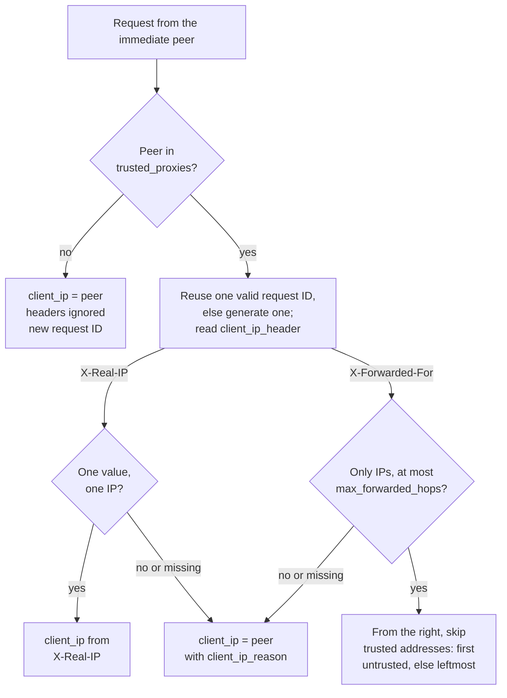

# Security model

**statica** serves one publication prefix of one bucket as a public website. This page names who is trusted, states the rule that holds at each boundary and links to the page that describes it in full. Client IP attribution and request IDs are described here.

## Trust boundaries

| Party | Controls | Trusted |
| --- | --- | --- |
| Visitors | Request targets, headers, connection timing | No |
| Operators | Configuration, credentials, network placement, the admin listener | Yes |
| Publishers | Every object under the publication prefix and its metadata | Yes, as content |

::: danger A private bucket becomes a public site
The process reads the bucket with its own credentials and serves every object under the publication prefix to anyone who can reach the public listener. A bucket that is private in S3 does not keep its published objects private. Put only public content under the prefix.
:::

::: danger Publisher content is trusted
Objects are served as they are stored: statica does not inspect or sanitize HTML, scripts or SVG, so anything placed under the prefix runs with your site's origin in visitors' browsers. Do not let untrusted users write under the publication prefix.
:::

statica does not authenticate visitors, filter requests or limit request rates: its [limits](./index.md#design-principles) protect the process, and a single client can still use all of the capacity they allow.

## Requests cannot leave the publication prefix

Every request target is validated before it becomes an object key, and the key is built by concatenation, never by cleaning a path: the path is decoded exactly once, a `.` or `..` segment, an encoded separator or a double encoding is rejected, a hidden segment gets 404 Not Found, and the query never selects an object ([target validation](./request-flow.md#target-validation)).

The origin client checks every key again before it sends a request: the key must start with the publication prefix, fit in 1024 bytes and contain no empty, `.` or `..` segment, backslash or control character. Configured keys (`index`, `not_found`, `spa.fallback`, `admin.origin_health.key`) are validated as safe relative keys when the configuration loads, and `s3.prefix` is normalized and validated the same way.

## Host never selects the origin

The bucket, the endpoint and the publication prefix are fixed when the process starts. The `Host` of a request is validated, normalized and used for admission, logs and metrics only: it never selects a bucket, a prefix or an object, and it is not part of a memory cache entry's identity ([host admission](./request-flow.md#host-admission)). Forwarded host headers such as `X-Forwarded-Host` are never read. Redirect rules cannot be steered either: a destination's origin is written literally in the rule, and captured request values only fill its path and query.

The optional [`hosts`](../reference/configuration.md#hosts) list admits only the listed names; any other host gets 421 Misdirected Request before redirects, the memory cache or the origin are consulted. Rejected requests are counted by a fixed reason, without a host label, so names chosen by a client never reach the metrics through a rejection.

::: warning Host labels without an allowlist
Without `hosts`, every syntactically valid host name is admitted and becomes a `host` label value of the request metrics, whose series are never removed. A client that sends many different names makes the number of series, and the memory they use, grow without limit. Configure `hosts` whenever clients can reach the public listener directly.
:::

## TLS on the public listener

With [`server.tls`](../reference/configuration.md#server-tls), the public listener serves HTTPS only, with one certificate chain for every name: the TLS server name selects neither a certificate nor a site. Only `server.listen` is bound: statica never adds a cleartext listener or an HTTP to HTTPS redirect. It sends `Strict-Transport-Security` only when you set it in `headers.set`, and never infers HTTPS from forwarded headers such as `X-Forwarded-Proto`, which it does not read. The certificate and key are read only at startup. [Serve HTTPS directly](../guide/tls.md) walks through the setup.

## Trusted proxies and client IP attribution

The client IP of a request is the address of the immediate peer, the other end of the TCP connection, unless that peer is a proxy you trust. Only then does statica read the forwarded header named by `server.client_ip_header`:

The rules:

- [`server.trusted_proxies`](../reference/configuration.md#server-trusted-proxies) is a list of CIDR ranges. A range that trusts every address, such as `0.0.0.0/0` or `::/0`, is rejected, and an IPv4-mapped peer address is compared as plain IPv4.
- `server.client_ip_header` is `X-Forwarded-For` or `X-Real-IP`; statica reads only that header. The RFC 7239 `Forwarded` header is not supported.
- `X-Forwarded-For` values are read across all header lines, split on commas and parsed as bare IP addresses: an entry with a port, an empty entry or any other text invalidates the whole chain. The chain may hold at most `server.max_forwarded_hops` entries and at most 64 bytes per allowed hop in total.
- Walking from the right, statica skips the addresses of trusted proxies and takes the first untrusted one. If every entry is trusted, it takes the leftmost.
- `X-Real-IP` must appear once and hold one IP address.
- When attribution falls back to the peer, the access event says why in [`client_ip_reason`](../reference/logs.md#client-ip-reason).

::: warning Trust only your proxies
Any client whose address is inside `server.trusted_proxies` can choose the client IP that statica logs and the request ID that it reuses. List your proxies' own addresses, or the narrowest ranges that contain them, rather than a whole private network shared with other workloads. Configure each proxy to append the address it sees to `X-Forwarded-For`, and to overwrite `X-Real-IP` and the request ID header instead of passing a client's values through.
:::

The client IP is attribution, not authorization: statica makes no access decision from it, and it never becomes a metric label. The access log records the client IP and the peer address unless `observability.log_client_ip` is `false`. [Run behind a reverse proxy, CDN or ingress](../guide/behind-a-proxy.md#trust-only-your-proxies) shows how to configure the trusted ranges and the header.

## Request IDs

Every response that statica produces on the public listener carries a request ID in `X-Request-ID`, whatever the request header is called, and the `http_request` event logs it as `request_id`, with `request_id_source` set to `proxy` or `generated`.

- The ID from the header named by [`server.request_id_header`](../reference/configuration.md#server-request-id-header) is reused only when the immediate peer is inside `server.trusted_proxies`, the header appears exactly once, and its value has 1 to 128 characters among letters, digits, `.`, `_`, `:` and `-`.
- Otherwise statica generates one: 32 hexadecimal characters from 16 random bytes. For a trusted peer, `request_id_reason` says why its ID was not used. For an untrusted peer the header is ignored silently.

A request ID never becomes a metric label. [Pass request IDs](../guide/behind-a-proxy.md#pass-request-ids) shows how to reuse a proxy's IDs.

## Origin credentials

Credentials come from the standard AWS SDK credential chain, and the SDK refreshes temporary credentials. The configuration file has no credential fields, and unknown keys are rejected, so credentials cannot be written into it. Values substituted from environment variables with `${VAR}` are shown as `[REDACTED]` by `statica config print`.

Origin access is read-only: statica issues `GetObject` and `HeadObject` requests for keys under the publication prefix, and never lists, writes or deletes, even when the credentials allow it. An origin 403 Forbidden is a denial, never a missing object ([Access denied](./access-denied.md)).

Credentials never appear in logs or command output. Origin errors are reduced to a fixed classification before they reach the logs, the metrics or standard error, so provider error messages, signed URLs and endpoint addresses are never copied. [Provide credentials](../guide/s3-providers.md#provide-credentials) shows a read-only policy and the credential sources.

## Origin connections

- **Verified HTTPS by default.** Connections to the origin use TLS 1.2 or later and verify the certificate and host name.
- **`s3.insecure_skip_verify: true`** keeps encryption but skips certificate and host name verification for origin requests, health checks included. Requests to credential providers always keep full verification. The `startup` event reports it and is followed by the `origin_tls_verification_disabled` warning, and `statica config check-origin` prints a warning too. The setting is rejected with an `http://` endpoint.
- **`s3.allow_http: true`** is required for an `http://` `s3.endpoint`. Requests, their signatures and object data then cross the network unencrypted.
- **Fixed destination.** Only `s3.endpoint` selects a custom endpoint; endpoint overrides from the AWS environment or shared configuration are ignored. Redirects from the origin are never followed.
- **Proxies.** Origin and credential requests honor the standard `HTTP_PROXY`, `HTTPS_PROXY` and `NO_PROXY` environment variables.

::: danger Unverified origin TLS
With `s3.insecure_skip_verify: true`, anyone who can intercept the connection to the origin can read and alter the site's content. Use it only to reach a test endpoint with a certificate you cannot otherwise trust.
:::

[Keep origin TLS verified](../guide/s3-providers.md#keep-origin-tls-verified) shows how to trust a private certificate authority instead.

## Response safety

Only an allowlist of origin metadata reaches visitors; user-defined object metadata and any other origin header are never forwarded, and a CR, LF or NUL in a metadata value makes the whole origin response invalid ([origin metadata](../reference/http-responses.md#origin-metadata)). Every response that statica produces on the public listener carries `X-Content-Type-Options: nosniff` and `X-Request-ID`. Responses that statica generates itself, such as errors and redirects, have a short plain-text body naming the status, carry `Cache-Control: no-store` and never include origin error details.

[`headers.set`](../reference/configuration.md#headers-set) adds static headers, such as a `Content-Security-Policy`, to every response; the names that statica controls are reserved and rejected when the configuration loads, and values cannot contain control characters other than tab.

CORS is off unless you set `cors.allowed_origins`. Only exact origins match, credentials are never allowed, and only `GET` and `HEAD` are granted ([CORS preflight](./request-flow.md#methods-and-cors-preflight)). CORS controls what browsers let other sites read; it is not access control: a request from an origin that is not allowed is still served, without a grant.

### Responses statica does not produce

Go's HTTP server rejects a few malformed requests before statica sees them, for example an HTTP/1.1 request without `Host` or request headers larger than `server.max_header_bytes`. Those responses carry no `X-Request-ID`, no `nosniff` and none of the `headers.set` headers, and they are neither logged nor counted in the metrics ([statuses from Go's HTTP server](../reference/http-responses.md#statuses-from-go-s-http-server)).

## Safe logging

Log values are escaped and bounded, so a hostile value cannot start a new line or forge an event. Request headers other than the host, redirect destinations, provider error messages and credentials are never logged, and the values of the query parameters listed in `observability.redact_query_params` are redacted. Events go through a bounded queue: when standard output stalls, new events are dropped and counted instead of slowing requests. The [log reference](../reference/logs.md#what-is-never-logged) lists what is logged and what never is, and [Keep secrets and personal data out](../guide/logs.md#keep-secrets-and-personal-data-out) shows how to adjust redaction and client IPs.

Metric labels never contain paths, object keys, queries, IP addresses or request IDs: request data reaches a label only as the `host` of admitted requests ([labels](../reference/metrics.md)).

## The admin listener

The admin listener serves `/livez`, `/readyz` and `/metrics` in cleartext HTTP/1.1, without authentication, on `127.0.0.1:9090` by default. It has exactly three routes and no debug or profiling route, its own limits that are independent of the public listener's, and it reads in-memory state only: an unauthenticated client cannot cause S3 traffic or cost through it. The [admin endpoints reference](../reference/admin-endpoints.md) describes each route and limit.

::: danger Keep the admin listener private
Anyone who reaches the admin listener can read your metrics, including the host names of admitted requests, traffic volumes and the exact build version, and watch readiness. Bind it to loopback or to a private network, and restrict access to it with your network controls. Never expose it to the internet.
:::

## Related pages

- [Response headers and CORS](../guide/headers-and-cors.md): set security headers and CORS grants.
