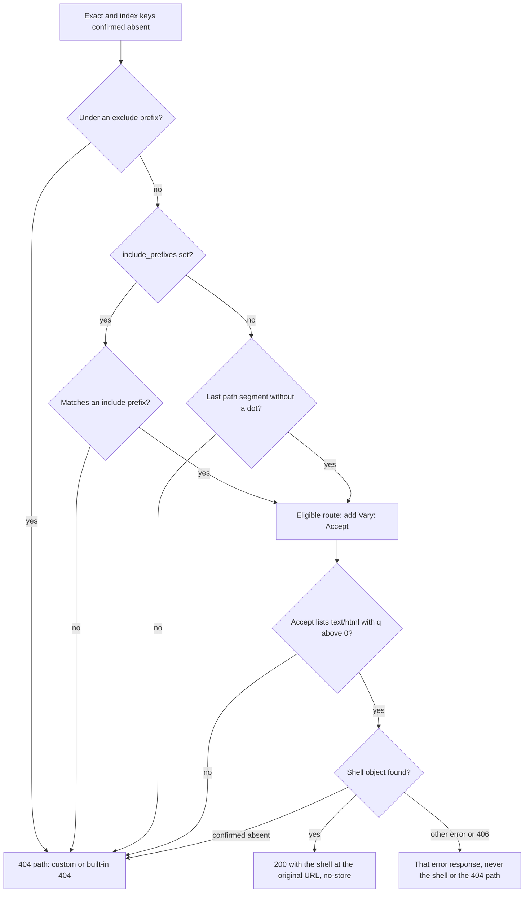

# SPA fallback

A single-page application (SPA) routes its URLs in the browser. When a visitor opens or reloads a deep link such as `/app/orders/42`, the browser asks **statica** for a URL that usually has no object in the bucket. The optional `spa` configuration block lets statica answer such a request with the application shell, an object you name (typically `index.html`), at the original URL and with status 200 OK, so that the application can start and render the route itself. The fallback is opt-in. It applies only to browser navigations on eligible routes: paths under `spa.include_prefixes` or, when that list is omitted, every path whose last segment has no dot. It runs only after statica has confirmed that no object answers the URL. [Serve a single-page application](../guide/single-page-apps.md) shows how to configure it for an application.

```yaml [config.yaml]
spa:
  fallback: index.html
  include_prefixes: [/app/]
  exclude_prefixes: [/app/assets/, /api/]
```

## How statica decides

The fallback is the last step before the 404 path. Once the exact and index lookups of a GET or HEAD request have confirmed that the URL has no object, statica runs the checks below, in this order.



## Where the fallback sits

The shell is the third candidate of [resolution](./request-flow.md#from-path-to-object): redirect rules, the exact key, and the index object with its 308 to the trailing-slash path all come first, and the custom 404 page comes after.

Only a confirmed absence moves resolution to the next step: the origin's definite "no such key" answer, or a negative entry in the memory cache. Any other result for any of these keys, such as a timeout, a provider error or a 403 Forbidden, ends resolution with an error response. The shell never replaces an error. See [Access denied](./access-denied.md) for the 403 case.

## Eligibility rules

A request receives the shell only when all of these hold:

- the configuration has an `spa` block (without it there is no fallback at all);
- the request is a GET or a HEAD;
- the path has no hidden segment: a path with a segment that starts with a dot, other than a first `.well-known` segment, gets 404 Not Found before any lookup and never reaches the fallback;
- the exact and index lookups confirmed that the URL has no object;
- the path is not under any of `spa.exclude_prefixes`;
- the path matches one of `spa.include_prefixes` or, when that list is omitted, its last segment contains no dot;
- the `Accept` header explicitly accepts `text/html`.

### Explicit HTML acceptance

Browsers list `text/html` in the `Accept` header of a navigation. Scripts, stylesheets, images and API calls usually ask for other types or for `*/*`. The fallback requires a member of `Accept` whose media type is exactly `text/html` (compared without case; media parameters are allowed) with a quality above zero. `*/*` and `text/*` do not count. A missing script, image or API response therefore stays a 404 instead of becoming an HTML page with status 200.

- When `text/html` appears more than once, the lowest quality applies.
- `q=0` refuses HTML. A `text/html` member whose parameters do not parse, or whose `q` is quoted or is not a valid quality (`0` or `1`, optionally followed by a point and up to three digits, at most `1.000`), counts as a refusal.
- A request without an `Accept` header is not eligible.

| `Accept` | Eligible |
| --- | --- |
| `text/html` | yes |
| `text/html;q=0.1, application/json` | yes |
| `*/*` | no |
| `application/json` | no |
| `text/html;q=0, */*;q=1` | no |
| `text/html;q=wrong` | no |

### Include and exclude prefixes

Each prefix is an absolute path that starts and ends with `/`, written in decoded form (no percent escapes), and unique within its list. Configuration validation enforces these rules at startup. An empty `include_prefixes` list is rejected; an empty `exclude_prefixes` list is valid.

- A prefix matches at a directory boundary: `/app/` matches `/app`, `/app/` and every path below it, but not `/application`. The prefix `/` matches every path.
- Matching uses the decoded request path, before any index mapping. The query string plays no part.
- Exclusions always win, also when an include prefix overlaps them: with `include_prefixes: [/app/]` and `exclude_prefixes: [/app/assets/]`, a missing `/app/assets/bundle.js` is a 404.

### The extensionless heuristic

When `spa.include_prefixes` is omitted, a route is eligible when the last segment of its path, ignoring one trailing slash, contains no dot. Any dot counts, not only a known file extension.

| Path | Eligible without `include_prefixes` |
| --- | --- |
| `/orders/42` | yes |
| `/orders/42/` | yes |
| `/` | yes |
| `/missing.js` | no |
| `/releases/1.2` | no |
| `/users/jane.doe` | no |

Your application's route table is unknown to statica. If your routes contain dots, list their namespace in `spa.include_prefixes`.

### `[/]` versus omitting the list

`include_prefixes: [/]` and an omitted `include_prefixes` behave differently:

| Setting | Eligible paths (outside the exclusions) |
| --- | --- |
| `include_prefixes` omitted | paths whose last segment has no dot |
| `include_prefixes: [/]` | every path, dotted or not |

With `[/]`, a missing `/bundle.js` requested with `Accept: text/html` (for example, opened directly in a browser tab) receives the shell. Use `exclude_prefixes` for asset and API namespaces when you include broadly.

## The response

- The status is 200 OK and the URL does not change: statica selects the shell internally, without a redirect. The query string stays in the browser's URL and never selects an object.
- The body and its content headers (`Content-Type`, `Content-Length`, `ETag`, `Last-Modified` and, for a precompressed variant, `Content-Encoding`) come from the shell object.
- `Cache-Control` is always `no-store`, whatever the shell's own metadata and any `cache_control` rule say. The response carries no `Expires` and no `Age`.
- Once the exact and index lookups have missed and the path passes the prefix rules, the response carries `Vary: Accept`, whether it is the shell or the 404 that follows a refusal or a missing shell, because another `Accept` value would select a different response. A URL answered by its own object, and a path that the prefix rules exclude, do not get it.
- Every response built from resolution also carries `Vary: Accept-Encoding` (see [Precompressed variants](./precompressed-variants.md#vary-accept-encoding)), and `Vary: Origin` when `cors` is configured. The values are merged as separate `Vary` field lines; none replaces another.
- A HEAD request follows the same selection and receives the same status and headers, without a body.
- Conditional requests and byte ranges apply to the shell as to any other 200 response. See [Ranges and conditional requests](./ranges-and-conditionals.md).
- With `compression.mode: precompressed`, the shell is negotiated like any object, so a published `index.html.br` can be served for it.

## When the shell is missing or the origin fails

- If the shell object is confirmed absent, statica continues once to the 404 path: the custom 404 page if configured, otherwise the built-in body. The 404 keeps `Vary: Accept`. No key is read twice in one request, so a shell that is also the custom 404 page is not fetched again, and nothing recurses.
- If the origin fails for the exact key, the index key or the shell, statica answers with the error that failure produces (for example 502 Bad Gateway, 503 Service Unavailable or 504 Gateway Timeout, and a 404 or 502 for a denied read, depending on `errors.access_denied`). It never answers such a failure with the shell.

## Caching

- The memory cache stores the shell once, under its own object key and with the memory cache policy of its object path (for example `/index.html`). Every route, host and query string that selects the shell shares that entry.
- Each distinct route still costs its own absence lookups: the exact key and the index key under it (only the index key for a path ending in `/`). With `compression.mode: precompressed` and an `Accept-Encoding` header, each of them adds one key per acceptable coding. Each confirmed absence becomes a negative entry for `cache.negative_ttl`, so a repeated route is answered from memory until the entry expires. A new route, such as a new order ID, costs a new set of lookups.
- Negative entries count against `cache.max_entries` like any other entry, so many distinct routes, such as one per order ID, can push other objects out of memory.
- `Cache-Control: no-store` keeps browsers and shared caches from storing the shell under route URLs. The memory cache may still serve the shell until its entry needs revalidation; a memory cache rule (`cache.rules`) for the shell's path controls how long that is.

## Observability

- The access log event (`http_request`) records `resolution=spa`, the original requested path in `path`, and in `origin_key` the object key of the representation served, publication prefix included, for example `site/index.html` or, for a precompressed variant, `site/index.html.br`.
- Metrics have no resolution or path label. Shell responses count under the ordinary host, method, status and outcome series, so an application route never becomes a metric label.

## Implications

::: warning Unknown routes return 200
Every eligible URL that has no object returns status 200 with the shell, including mistyped and obsolete links. Search engine crawlers, link checkers and status-based monitoring see 200, not 404. Your application must render its own "not found" view for routes it does not know. Exclude namespaces where a 404 matters, such as assets and APIs.
:::

- A custom 404 page is different: it keeps status 404 and does not stand in for a client-side route.
- Without `include_prefixes`, a route whose last segment contains a dot gets a 404 instead of the shell.
- Under an included prefix, a missing asset opened directly in a browser tab receives the shell, because the browser then sends `Accept: text/html`. Exclude asset namespaces to keep those 404s.

## Related pages

- [Negative entries](./memory-cache.md#negative-entries): how confirmed absences are kept in memory.
- [Configuration reference](../reference/configuration.md#spa): the `spa` keys.
