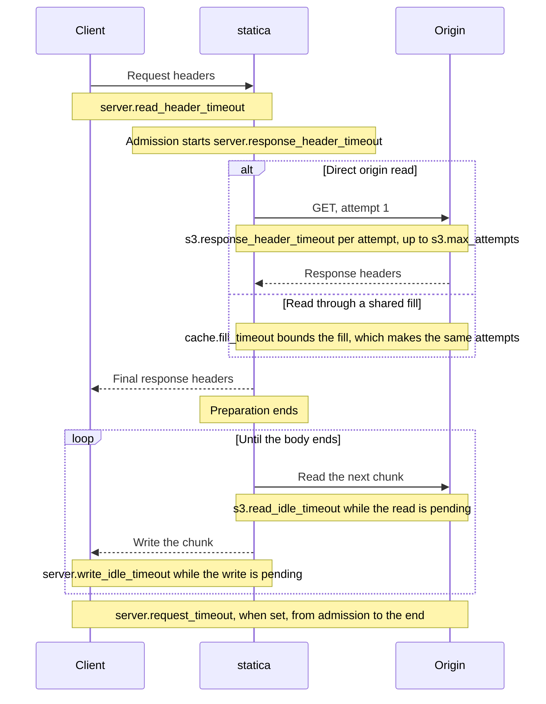

# Timeouts and long downloads

Each phase of a request has its own limits instead of one deadline for the whole request: receiving the request headers, preparing the response (all origin work up to the final response headers), and moving body bytes, with separate inactivity limits for origin reads and client writes. A transfer that keeps making progress is never cut by default, whatever its size or duration. `server.request_timeout` adds an absolute ceiling when you want one.

## The phases of a request

The diagram follows one GET whose body streams from the origin, and shows which limit applies during each phase.

A body served from the memory cache has no origin reads: only the client write limit applies while it streams.

## The limits

| Key | What it bounds | On expiry |
| --- | --- | --- |
| `server.read_header_timeout` | Receiving one request's headers and, on a new TLS connection, the handshake | The connection is closed without a response |
| `server.response_header_timeout` | Preparation: from admission to the final response headers, including credential lookups, every origin attempt and its backoff, waits for shared fills and a guarded range read | 504 Gateway Timeout |
| `s3.response_header_timeout` | Each origin HTTP attempt, from sending the request to receiving the response headers | The attempt fails as a timeout; another attempt may follow |
| `s3.max_attempts` | Attempts per origin operation, retries included; the backoff between attempts is at most 500 ms | After the last attempt, the operation fails |
| `s3.read_idle_timeout` | One pending read of an origin body | 504 before the response headers, an aborted transfer after them |
| `server.write_idle_timeout` | One pending write or flush to the client, headers included | The transfer is aborted |
| `server.request_timeout` | The whole request from admission, body included; `0s` disables it | 504 before the response headers, an aborted transfer after them |
| `cache.fill_timeout` | One shared fill or revalidation, from its start | Requests waiting for it get 504 |
| `server.idle_timeout` | A keep-alive connection waiting for its next request | The connection is closed |
| `server.shutdown_timeout` | The whole graceful shutdown | Requests still active shortly before the budget ends, at `server.shutdown_timeout` minus `min(server.shutdown_timeout/4, 1s)`, are canceled |

When a stored copy exists and `cache.stale_if_error` allows it, a fill or revalidation that fails with an origin timeout serves that copy instead of a 504.

Connecting to the origin, and to AWS credential providers, is bounded per attempt: the connection may take up to 30 seconds and its TLS handshake up to 10 seconds, each at most `s3.response_header_timeout`, all inside the preparation budget. An origin that does not answer connection attempts therefore fails each attempt like an origin that sends no headers, and `cache.stale_if_error` can serve a stored copy instead. `statica config check-origin` uses `server.response_header_timeout` as the deadline of its whole check.

### The preparation budget

`server.response_header_timeout` is one budget per request. It starts when the request is admitted, that is when it takes a request slot, and ends when statica commits the final response headers. Origin attempts, backoff, credential lookups, waiting for another request's shared fill, and the guarded read of a range all spend from it. Retries do not restart it. Once the headers are sent, the budget is gone and cannot cancel the body that follows.

### Inactivity, not duration

`s3.read_idle_timeout` and `server.write_idle_timeout` measure inactivity of one operation, not the length of the transfer. A streamed body moves in chunks of up to 32 KiB: statica reads one from the origin, then writes it to the client. As a result:

- the origin timer runs only while statica waits for the origin to deliver data;
- the client timer runs only while statica waits for a write or flush to the client to complete, and every completed write starts it afresh.

A download that keeps making progress therefore continues for as long as it needs, unless `server.request_timeout` is set.

### Shared fills

When several requests miss the memory cache for the same key, one shared fill reads the object for all of them. `cache.fill_timeout` bounds that fill from its start and is not extended when later requests join. Each waiting request keeps its own deadlines: a request that gives up leaves without canceling the fill. The fill is canceled only when its last waiter has left, when its own timeout expires, or at shutdown. When a fill hands an object it cannot keep in memory to one request as a stream, the fill's timer stops: from then on only that request's limits apply, so `cache.fill_timeout` never cuts a long download.

## The earliest deadline wins

Every operation is bounded by the earliest limit that applies to it:

- the preparation budget and `server.request_timeout` both run from admission, and whichever expires first ends the preparation;
- each client write is bounded by `server.write_idle_timeout` or by the remaining `server.request_timeout`, whichever is sooner;
- origin attempts, backoff and fill waits all happen inside the preparation budget, so `s3.response_header_timeout` and `s3.max_attempts` can end the preparation earlier but never extend it.

A short `server.request_timeout` can therefore end a request before any phase limit does.

## Before and after the response headers

What a client sees depends on whether statica has already sent the status line.

### Before the headers

The status is not sent yet, so it can still reflect the failure:

| Cause | Status | `termination_reason` |
| --- | --- | --- |
| The preparation budget expires | 504 Gateway Timeout | `preparation_timeout` |
| An origin timeout ends the preparation: attempts exhausted, a stalled read while filling the memory cache, or `cache.fill_timeout` | 504 Gateway Timeout | `preparation_timeout` |
| `server.request_timeout` expires | 504 Gateway Timeout | `total_deadline` |
| Shutdown cancels the request | 503 Service Unavailable | `shutdown` |
| The client disconnects | (nothing is delivered) | `disconnect` |

The 504 and 503 responses have a short generated body and `Cache-Control: no-store`, and the request is logged with `outcome=origin_failure`; the 504 with `error_class=origin_timeout`. Even when the budget has expired, statica still writes this final response, bounded by `server.write_idle_timeout`. A redirect or rejection that statica generates after the budget has expired is also answered with 504 Gateway Timeout.

A client that disconnects receives nothing and is not an origin failure: the request is logged with `status=0`, `outcome=incomplete` and no `error_class`, and counted in `statica_stream_failures_total{reason="disconnect"}`. A client that half-closes its connection, sending FIN after its request, counts as gone too.

### After the headers

The status is already on the wire and cannot change, and no error page is ever appended to a started body. When a transfer fails, statica aborts it: an HTTP/1.1 connection is closed, and an HTTP/2 stream is reset while the connection keeps serving its other streams. The client receives a truncated body: fewer bytes than `Content-Length` announced, or a chunked body without its end.

The request is logged with `outcome=incomplete`, its partial `bytes_written` and a [`termination_reason`](../reference/logs.md#termination-reason), and counted in `statica_http_requests_total{outcome="incomplete"}` and `statica_stream_failures_total`, labeled by reason:

| `termination_reason` | Cause | Log level |
| --- | --- | --- |
| `origin_read_timeout` | `s3.read_idle_timeout` expired during an origin read | `error` |
| `origin_read_failure` | Reading the origin body failed for another reason | `error` |
| `checksum_mismatch` | The origin body failed checksum validation (`s3.features.checksums`) | `error` |
| `length_mismatch` | statica counted more or fewer body bytes than the announced length | `error` |
| `client_write_timeout` | `server.write_idle_timeout` expired during a write | `warn` |
| `client_write_failure` | A write to the client failed | `warn` |
| `disconnect` | The client went away | `warn` |
| `total_deadline` | `server.request_timeout` expired | `warn` |
| `shutdown` | Shutdown canceled the transfer | `warn` |

## Slow clients and slow origins

The two inactivity limits never blame one side for the other:

- **A slow client.** While statica waits for a write to complete, no origin read is pending, so the origin timer does not run. A client that receives slowly but steadily is never cut by `server.write_idle_timeout`; a client that stops reading is, and is logged with `client_write_timeout`.
- **A slow origin.** While statica waits for origin data, no client write is pending, so the client timer does not run. An origin that stalls longer than `s3.read_idle_timeout` ends the transfer with `origin_read_timeout`.

Progress is measured at statica's own I/O boundary: bytes accepted into socket or protocol buffers count as written, even if the client has not received them yet.

## HTTP/2

HTTP/2 is offered through TLS negotiation when `server.tls` is configured; without TLS, only HTTP/1.1 is served. With HTTP/2, the write inactivity limit, the origin read limit and `server.request_timeout` apply to each stream on its own. A stream that times out or fails is reset, and the other streams of the same connection continue. Each stream takes its own request slot, while the connection counts once against `server.max_connections`.

## Request and connection capacity

- **Requests.** `server.max_concurrent_requests` is the number of request slots. A request takes a slot as soon as its headers are read, or is rejected at once with 503 Service Unavailable: there is no queue. The rejection is logged at `warn` with `error_class=request_capacity` and counted in `statica_http_rejected_requests_total{reason="request_capacity"}`. A slot is held until the response ends, so a long download holds its slot for its whole duration.
- **Connections.** `server.max_connections` caps open connections on the public listener. At the cap, statica stops accepting: new connections wait in the operating system's listen backlog, whose size and overflow behavior the operating system controls, and are accepted as other connections close. Connections in a TLS handshake and idle keep-alive connections count against the cap.

The admin listener has its own limits, so a saturated public listener does not block `/livez`, `/readyz` or `/metrics`.

## Long downloads and resumption

- With `server.request_timeout: 0s`, statica sets no limit on the duration of a transfer: only the inactivity limits apply.
- A positive `server.request_timeout` sets an absolute ceiling for every request, small assets included, measured from admission.
- A slow transfer holds a request slot and a connection for as long as it runs.
- An interrupted transfer is neither retried nor resumed by statica. Clients that support resumption, such as download managers or `curl --continue-at -`, request the missing bytes with `Range`. Adding `If-Range` protects a client against a changed object: statica serves such a range under the rules in [Ranges and conditional requests](./ranges-and-conditionals.md), and if the object changed, `If-Range` no longer matches and the client receives the complete new object with 200.
- Proxies and load balancers in front of statica have their own timeouts and can end a long transfer on their own. Align them with the limits above ([Align the time limits](../guide/behind-a-proxy.md#align-the-time-limits)).

## Shutdown cuts long downloads

On a shutdown signal, statica stops accepting connections and lets active requests continue within `server.shutdown_timeout`. Shortly before the budget ends, at `server.shutdown_timeout` minus a reserve of a quarter of the budget capped at one second, it cancels the requests still active. Their transfers end incomplete with `termination_reason=shutdown`, whatever their own limits are: a disabled `server.request_timeout` does not extend shutdown. Give your process manager a termination grace period longer than `server.shutdown_timeout` ([Grace period and pre-stop delay](../guide/deployment.md#grace-period-and-pre-stop-delay)).

## What statica does not do

- It does not use whole-connection read or write deadlines, which would cut downloads that are still progressing.
- It does not retry an origin read once the response headers are sent, and does not resume interrupted downloads.
- It does not queue requests beyond `server.max_concurrent_requests`.
- It does not rate-limit clients or apply per-client limits.

## Related pages

- [Request flow and URL mapping](./request-flow.md): admission and request capacity.
- [Memory cache](./memory-cache.md): shared fills and their limits.
- [Startup, readiness and shutdown](./lifecycle.md): the shutdown schedule in detail.
- [Ranges and conditional requests](./ranges-and-conditionals.md): how a client resumes a download.
- [Access denied](./access-denied.md): an origin failure that is not a timeout.
- [Run behind a reverse proxy, CDN or ingress](../guide/behind-a-proxy.md#align-the-time-limits): aligning a proxy's timeouts with statica's.
- [Deploy, roll out and shut down](../guide/deployment.md#shut-down-without-cutting-requests): the grace period around `server.shutdown_timeout`.
- [Log reference](../reference/logs.md#termination-reason): every `termination_reason`.
- [Configuration reference](../reference/configuration.md): every timeout key.
