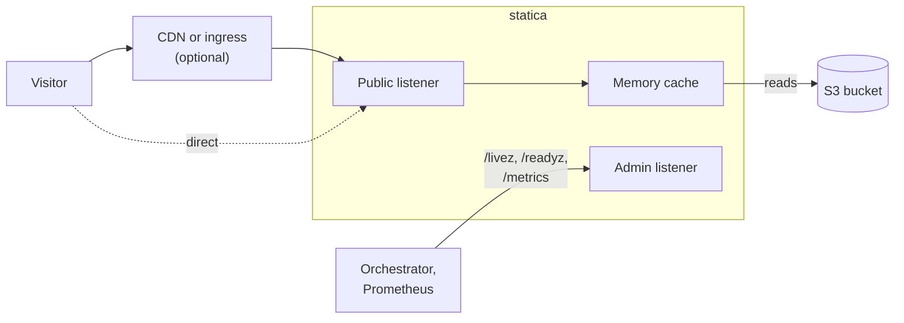

## A minimal configuration

This configuration serves the bucket `example-websites`, in the AWS region `eu-west-1`, as a website:

<<< @/examples/minimal.yaml{yaml}

Save it as `config.yaml` with your own bucket and region. With statica [installed](./guide/installation.md) and on your `PATH`, check the file and start the server:

```sh
statica config validate --config config.yaml
statica serve --config config.yaml
```

The defaults put the site on `127.0.0.1:8080` and the admin endpoints on `127.0.0.1:9090`, enable a memory cache of up to 128 MiB, and serve `index.html` for paths that end in `/`. The [Quickstart](./guide/quickstart.md) installs statica and walks through each step, and [Configuration basics](./guide/configuration.md) explains the file.

## How it fits

Visitors reach the public listener directly or through a CDN or ingress, and orchestrators and Prometheus use a separate admin listener.



One instance serves one site. Instances that serve the same site do not share their memory caches.

## Where to go next

- [Guide](./guide/what-is-statica.md): install, configure, deploy and monitor statica, task by task.
- [Architecture](./architecture/index.md): how a request is mapped to objects, how the memory cache works, and how statica starts and shuts down.
- [Reference](./reference/configuration.md): every configuration field, CLI command, HTTP response, log event and metric.
