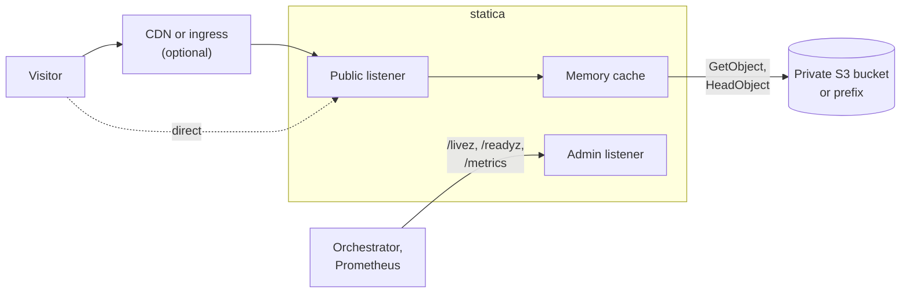

## A minimal configuration

This configuration serves the bucket `example-websites`, in the AWS region `eu-west-1`, as a website:

<<< @/examples/minimal.yaml{yaml}

Save it as `config.yaml` with your own bucket and region. With statica [installed](./guide/installation.md) and on your `PATH`, validate the file, check access to the bucket and start the server:

```sh
statica config validate --config config.yaml
statica config check-origin --config config.yaml
statica serve --config config.yaml
```

The defaults put the site on `127.0.0.1:8080` and the admin endpoints on `127.0.0.1:9090`, enable a memory cache of up to `128MiB`, and serve `index.html` for paths that end in `/`. The [Quickstart](./guide/quickstart.md) installs statica and walks through each step, [Configuration basics](./guide/configuration.md) explains the file, and [Configuration examples](./reference/examples.md) shows complete configurations for single-page apps, TLS and reverse proxies.

## How it fits

Visitors reach the public listener directly or through a CDN or ingress, and orchestrators and Prometheus use a separate admin listener.



One instance serves one site, and instances that serve the same site keep separate memory caches. Because statica authenticates through the standard AWS credential chain and sends only `GetObject` and `HeadObject` requests, the bucket can stay private and read-only.

## Where to go next

- [What is statica?](./guide/what-is-statica.md): the problem it solves, its capabilities, and [what it leaves to other tools](./guide/what-is-statica.md#what-statica-does-not-do).
- [Quickstart](./guide/quickstart.md) and [Installation](./guide/installation.md): run the release binary, the container image or a build from source.
- [Architecture](./architecture/index.md): how a request is mapped to objects, how the memory cache works, and how statica starts and shuts down.
- [Reference](./reference/configuration.md) and [Examples](./reference/examples.md): every configuration field, CLI command, HTTP response, log event and metric, alongside complete example configurations.
